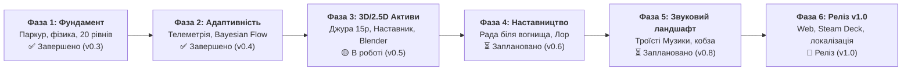

# 🗺️ Дорожня карта розробки (ROADMAP.md)
## «Джура: початок шляху козака» (*Djura: Path of the Cossack*)

Цей документ визначає стратегічні етапи (Milestones), задачі та технічні цілі розвитку проєкту відповідно до [**Game Design Document (GDD)**](docs/GDD.md), архітектурних рішень (ADR) та інваріантів якості.

---

## 🧭 Візуальна схема етапів (Milestones Overview)

---

## 🎯 Детальний опис фаз розвитку

### 🟢 Фаза 1: Фундамент, фізика та рівні (Core Engine & Levels) — v0.1 .. v0.3
*Статус:* **ВИКОНАНО (100%)**
- [x] Реалізація процедурного 2D-рушія персонажа у стилі «Київнаукфільм» (`scripts/player.gd`).
- [x] Фізика козацького паркуру: ширяння на киреї (Cossack Glide), стрибки крізь балки знизу вгору, гасіння удару об кам'яні склепіння.
- [x] Аналітична зворотна кінематика (2-Bone IK) для прийомів Бойового Гопака («пістоль»).
- [x] Базові інженерні інваріанти:
  - **I-1 (Детермінізм):** стабільна фізика та розрахунок парабол;
  - **I-3 (Zero-Horror):** без кривавого насилля, комічні реакції ворогів;
  - **I-4 (Anti-Clipping):** прив'язка підошов до $Z = 0$ (`y = 16`).
- [x] Кампанія з 20 рівнів із 4 актами оточення (`LEVEL_COMPOSITIONS`, `LEVEL_PLATFORMS`, `LEVEL_BOMBS`).
- [x] Headless-набір автоматизованих тестів (`tools/run_tests.sh`, 14/14 PASS).

---

### 🟢 Фаза 2: Адаптивна складність та незалежна телеметрія — v0.4
*Статус:* **ВИКОНАНО (100%)**
- [x] Розробка вимог та архітектури: [SHR-003](docs/SHR-003-adaptive-difficulty-and-independent-telemetry.md), [SWR-002](docs/SWR-002-adaptive-model-and-telemetry.md), [ADR-002](docs/ADR-002-bayesian-flow-adaptation.md).
- [x] Модуль телеметрії та класифікатор стилю гравця (`scripts/telemetry.gd`, `scripts/telemetry_engine.gd`).
- [x] Байєсівська модель гравця (Bayesian Flow Adaptation, бандит Томпсона, оцінка Раша у `scripts/player_model.gd`).
- [x] Дорадчий аналітичний контур на Jetson AGX Orin (`phi4-mini`, `gemma3:12b`, `deepseek-r1:14b`).
- [x] Автоматичні тести адаптивної кривої складності (`test/test_adaptive_model.gd`, `test/test_difficulty_curve.gd`).

---

### 🟡 Фаза 3: Візуальний 3D $\to$ 2D конвеєр та нові активи — v0.5
*Статус:* **В РОБОТІ (80%)**
- [x] Створення 360° кругового концепт-арту Джури 15 років через Gemini Ultra (Imagen 3).
- [x] ШІ-реконструкція високополігональної моделі Джури 15 років ([`assets/models/djura_meshy.glb`](assets/models/djura_meshy.glb), 403k полігонів, PBR).
- [x] Інтеграція 3D-моделі Радника-Наставника ([`assets/models/mentor_cossack.glb`](assets/models/mentor_cossack.glb), 50 МБ).
- [x] Підготовка нативних сцен у Blender 5.0.1 з вирівнюванням опорної підлоги $Z = 0$:
  - `assets/models/djura_meshy.blend`
  - `assets/models/mentor_cossack.blend`
  - `assets/models/djura_reference_studio.blend`
- [x] Студійний рендеринг перегляду в `reports/` та аудит на Jetson AGX Orin (`gemma3:12b`).
- [ ] Ригінг (скелет) та запікання 7 дій анімації моделі Джури в Blender (`idle`, `run`, `jump`, `glide`, `hopak_kick`, `bonk`, `victory`).
- [ ] Headless-рендеринг оновленого 2.5D спрайт-атласу високої роздільної здатності (`assets/sprites/djura_sheet.png`) через EEVEE Next Cel-Shader.
- [ ] Тестування гарячого перемикання `F6` у грі та підтвердження відсутності артефактів.

---

### ⏳ Фаза 4: Система наставництва та сценарний ЛОР — v0.6 .. v0.7
*Статус:* **ЗАПЛАНОВАНО**
- [x] Оформлення канонічного [Game Design Document (GDD)](docs/GDD.md) та розділу «ЛОР ТА СВІТОБУДОВА».
- [ ] Оновлення інтерфейсу сюжетних карток між рівнями (`scripts/story_cards.gd`):
  - Поява 3D/2.5D фігури Радника (Козака-Шабельника) біля вечірнього вогнища;
  - Динамічна оцінка стилю проходження Джури (на основі метрик `telemetry_engine.gd`);
  - Вручення лицарських заповідей та відкриття бойових умінь (Джеб Кличка, Ухил Усика, підківки Вакули, стріли Киримли).
- [ ] Розширення фабул для 5 історико-фольклорних локацій:
  - Хортицька Січ $\to$ Степовий Хутір $\to$ Кам'янецька Твердиня $\to$ Гетьманський Батурин $\to$ Перекоп і Бахчисарай.
- [ ] Створення сюжетних ілюстрацій для катсцен перепочинку за каноном золотого віку «Київнаукфільму».

---

### ⏳ Фаза 5: Звуковий ландшафт та Троїсті Музики — v0.8
*Статус:* **ЗАПЛАНОВАНО**
- [ ] Інтеграція автентичних українських народних інструментів:
  - Кобза та бандура (ліричні мелодії перепочинку біля вогнища);
  - Цимбали, сопілка, дримба та бубон з тарілочками (динамічний аркадний гопак);
  - Сурми та литаври (свято перемоги на Хортиці).
- [ ] Адаптивний динамічний саундтрек:
  - Зміна темпу та додавання шарів ударних ($2/4$) під час активних комбо та підхоплення Цвіту Папороті.
- [ ] Справжнє українське озвучення реплік Наставника (колоритні прислів'я, лицарські настанови).

---

### ⏳ Фаза 6: Полірування, доступність та публічний реліз — v1.0
*Статус:* **ЗАПЛАНОВАНО**
- [ ] Меню вибору профілю гравця (`8-10` / `11-14` / `15+`, досвід `novice` / `casual` / `experienced`) для зручної сімейної гри.
- [ ] Повна верифікація керування для геймпадів (Logitech F310, Xbox, DualShock/DualSense, Steam Deck OLED).
- [ ] Мовна локалізація:
  - 🇺🇦 Українська (основна канонічна версія);
  - 🌙 Кримськотатарська (Qırımtatar tili — репліки побратима Киримли, інтерфейс);
  - 🇬🇧 Англійська (для міжнародної аудиторії).
- [ ] Оптимізація та збірка під WebAssembly / PWA (гра без інсталяції в один клік у браузері).
- [ ] Публікація та підготовка релізу на itch.io / Steam.

---

## 📊 Матриця відстеження прогресу

| Компонент | Готовність | Цільова версія | Відповідальний |
| :--- | :---: | :---: | :--- |
| **Фізика та козацький паркур** | 100% | v0.3 | Рушій Godot / GDScript |
| **20 рівнів кампанії** | 100% | v0.3 | GameManager / LevelDesign |
| **Адаптивна складність (Bayesian DDA)** | 100% | v0.4 | TelemetryEngine / PlayerModel |
| **ЛОР та Game Design Document** | 100% | v0.5 | GDD.md / Документація |
| **3D-моделі Джури та Наставника** | 80% | v0.5 | Meshy AI / Blender 5.0 |
| **Екрани Ради біля вогнища (Campfire)** | 40% | v0.6 | StoryCards / UI |
| **Автентичний фолк-саундтрек** | 30% | v0.8 | Audio / SoundDesign |
| **Реліз v1.0 (PC / Web / Deck)** | 50% | v1.0 | Build & Release Pipeline |

---

## 🤝 Як доєднатися до розробки
Якщо ви бажаєте долучитися до реалізації одного з пунктів дорожньої карти, ознайомтеся з [**INSTALL.md**](INSTALL.md) та відкривайте відповідний Issue / Pull Request у [репозиторії на GitHub](https://github.com/nick-fedchik/djura).
