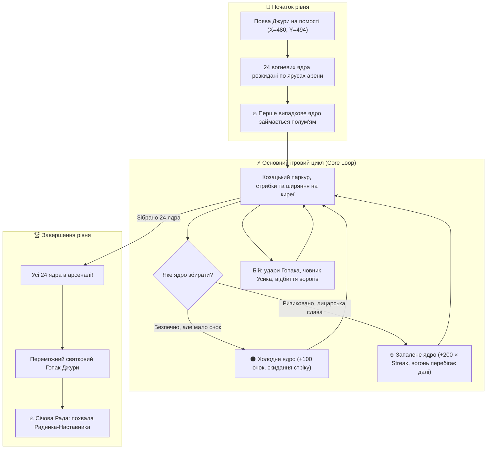
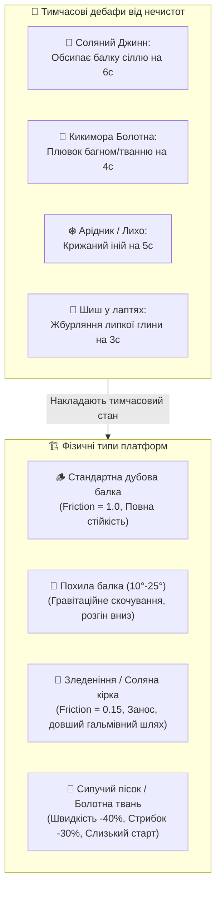

# ГЕЙМПЛЕЙ, ІГРОВІ МЕХАНІКИ ТА РЕГІОНАЛЬНА МІФОЛОГІЯ
## «Джура: початок шляху козака» (Djura: Path of the Cossack)

**Призначення документа:** Цей документ є деталізованою специфікацією ігрових механік, бойової системи, взаємодії з артефактами та геймплейного бестіарію регіональної міфології для гри «Джура». Він доповнює канонічний [**Game Design Document (`docs/GDD.md`)**](file:///home/mfedchyk/Godot/djura-1/docs/GDD.md).

---

## 1. Ядро ігрового циклу (Core Gameplay Loop)

Кожен рівень арени являє собою багатоярусну дерев'яно-кам'яну споруду (960×540 px), на якій розкидано **24 козацьких вогневих ядра**. Мета гравця — зібрати всі 24 ядра, ухиляючись від нечистот, відбиваючи нападників ударами Бойового Гопака та підтримуючи ланцюжок вогняного сяйва.

---

## 2. Головна аркадна механіка: Пасивні ядра проти Запалених ядер

Механіка ядер є серцем аркадного геймплею, успадкованою від класичної традиції *Bomb Jack*, але наповненою живим козацьким колоритом.

```mermaid
flowchart LR
    subgraph Passive["🌑 Холодне ядро (Пасивне)"]
        ColdLook["Темний матовий чавун зі згаслим гнотом"]
        ColdScore["Фіксована нагорода: +100 очок"]
        ColdReset["⚠️ Скидає поточний помножувач: Streak = 1"]
        ColdSound["Глухий металевий звук"]
    end

    subgraph Lit["🔥 Запалене ядро (Палаюче)"]
        LitLook["Палаючий гніт, купальські іскри, вогняна аура 24px"]
        LitScore["Множинна нагорода: +200 × Streak"]
        LitChain["✨ Вогонь перебігає на наступне ядро (ланцюжок триває)"]
        LitPitch["Звукове крещендо: підвищення тону з кожним ядром"]
        LitArtifacts["Визволення артефактів: Підківки Вакули, Цвіт Папороті"]
    end

    Passive -.->|Розриває ланцюжок| Lit
```

### 2.1. Візуальна та аудитивна відмінність у рушії (`scripts/bomb.gd`)
1. **Пасивне (холодне) ядро:**
   - Масивна чавунна куля з псевдо-3D градієнтним затіненням (10 ступенів концентричної освітленості).
   - Згаслий конопляний гніт угорі, відсутність світлового ореолу.
   - Звуковий ефект: короткий металевий звук удару (`snd_bomb_regular`).
2. **Запалене (палаюче) ядро:**
   - **Рівно одне на всій арені одночасно!**
   - Яскраво палаючий гніт із динамічним золотисто-помаранчевим полум'ям.
   - Пульсуюча вогняна аура радіусом 24 px (`Color(1.0, 0.45, 0.10, alpha)`).
   - Система часток: шість живих іскорок-емберів, що відлітають угору та гаснуть у повітрі.
   - Звуковий ефект: дзвінкий палаючий акорд (`snd_bomb_lit`), тон якого динамічно зростає: $\text{pitch} = 1.0 + (\text{streak} - 1) \times 0.05$ (до $1.8\times$).
   - HUD виводить золоте сповіщення: `ВОГНЕВЕ ЯДРО xN! +XXXX`.

### 2.2. Математика винагороди та наслідки помилки
| Ядро за чергою у стріку | Холодне ядро | Запалене ядро | Бонусні наслідки та вигуки Джури |
| :---: | :---: | :---: | :--- |
| **1-ше** | 100 | **200** | Початок вогняного ланцюжка |
| **2-ге** | 100 | **400** | Зростання темпу гри |
| **3-тє** | 100 | **600** | Вигук Джури *«Гей-га!»* + **Доставка Золотих Підківок Вакули** |
| **4-те** | 100 | **800** | Підвищення тону звуку |
| **5-те** | 100 | **1 000** | **Розквіт Цвіту Папороті** (режим Характерника) |
| **6-те** | 100 | **1 200** | Вигук Джури *«Козацькому роду нема переводу!»* |
| **10-те** | 100 | **2 000** | Вигук *«Оце так вогонь!»* + Другий Цвіт Папороті |
| **20-те** | 100 | **4 000** | Тріумфальне сяйво арени |

> [!WARNING]
> **Фатальний наслідок дотику до холодного ядра:**
> Якщо під час збору ланцюжка запалених ядер гравець випадково або кваплячись підбирає холодне ядро, **весь стрік миттєво згорає** (`lit_streak = 1`). Наступне запалене ядро принесе знову лише 200 очок замість кількох тисяч!

### 2.3. Пріоритет (Risk vs Reward)
* **Безпечна тактика новачка:** збирати ядра за найпростішим маршрутом. Рівень завершується, але дає мізерні $2\,400$ очок і не викликає супер-артефактів.
* **Лицарська тактика майстра:** полювати **виключно на запалене ядро**, де б воно не спалахнуло. Це вимагає розрахунку траєкторії ширяння на киреї, перекатів під бердишами та пікірування над головами ворогів. Ідеальний рівень дає **понад $50\,000$ очок**!

---

## 3. Магічні артефакти арени

### 3.1. Золоті Підківки Вакули (`scripts/vakula_horseshoe.gd`)
* **Як отримати:** Гарантовано випадають після збору 3 запалених ядер підряд (або коли на арені залишається 21 ядро).
* **Геймплейний ефект:**
  - Активують чарівну здатність взуття Джури — **стрибки крізь дощаті балки знизу вгору** (`is_one_way = true`).
  - Зверху Джура стає на помости твердо як на камінь, а знизу пролітає крізь них без перешкод.
  - Надають гравцеві повну вертикальну маневреність.

### 3.2. Цвіт Папороті (`scripts/power_flower.gd`)
* **Як отримати:** З'являється у повітрі на 5-му та 10-му запаленому ядрі стріку.
* **Геймплейний ефект (Режим Характерника):**
  - Джура спалахує сонячним світлом на 7 секунд (`is_charakterite = true`).
  - Усі вороги на арені (чортики, відьми, шиші, опричники) переходять у стан **комічного переляку** (`is_scared = true`): очі стають блюдцями, вони тікають у кутки й гублять лапті.
  - Будь-який дотик Джури до зляканого ворога миттєво виганяє його з арени з комічним хлопком (`_play_poof()`) і приносить великі бонусні очки (від 500 до 2500 очок залежно від чину ворога).

---

## 4. Регіональний бестіарій та міфологічні нечистоти у геймплеї

Кожен географічний регіон кампанії вводить унікальних фольклорних ворогів зі специфічною геймплейною поведінкою:

### 4.1. Кримські нечистоти (Таврида / Кримський Юрт)
| Ворог | Фольклорний образ | Поведінка та геймплейна механіка | Спосіб протидії |
| :--- | :--- | :--- | :--- |
| **Обур (Obur)** | Степовий перевертень-ненажера у вигляді перекотиполя | Швидко котиться зиґзаґом по нижніх ярусах, підіймає куряву та засмоктує ядра у свій глиняний глечик. | Удар чоботом «Тинок» розбиває глечик і повертає ядра на арену. |
| **Албасти (Albastı)** | Духаниця печерних скель Мангупа та Чуфут-Кале | Літає над верхніми карнизами й завішує платформу густою сонною імлою, приховуючи платформи. | Виклик бойового сокола Киримли, який розганяє імлу помахом крил. |
| **Соляний Джинн Сиваша (Cin)** | Маленький іскристий бісик із білих кристалів солі | Вистрибує із солончакових вибоїн, кидає соляні грудочки, які роблять дошки слизькими (інерція $\times 2$). | Ширяння на киреї без контакту зі слизькими дошками. |
| **Печерний Аждаха (Ejderha)** | Маленький товстенький дракончик із печер Ай-Петрі | Охороняє золоті схрони в гротах, періодично випускає нешкідливі, але засліплюючі кільця диму. | Стрибок згори з ударом Сокола. |

### 4.2. Карпатські нечистоти (Чорногора / Гуцульщина)
| Ворог | Фольклорний образ | Поведінка та геймплейна механіка | Спосіб протидії |
| :--- | :--- | :--- | :--- |
| **Чугайстер** | Веселий лісовий велетень у білому одязі зі смерекової кори | Блукає ареною, виграючи на денцівці. Коли починає танець — усі персонажі мимоволі пускаються в танок! | Ритмічне натискання кнопок Гопака в такт мелодії; після цього Чугайстер стає союзником. |
| **Щезник** | Гірський полонинський дідько у смушевій шапці | Телепортується по помостах з гучним хлопком і синім димком, хапає ядра й міняє їх місцями. | Прямий удар у момент матеріалізації. |
| **Карпатський Блуд** | Мерехтливий блукаючий лісовий вогник | Зависає над прірвами. При зіткненні інвертує керування (вліво стає вправо) на 3 секунди. | Обережне обминання на киреї. |
| **Песиголовець** | Дикий велетень із вовчою пащею в овечій шкурі | Повільно гупає верхніми балками й скидає вниз дерев'яні колоди. | Метання золотої бартки Гуцулика. |
| **Арідник** | Володар чорногорських громовиць на горі Піп-Іван | Насилає бічні пориви вітру, що зносять Джуру під час ширяння на киреї. | Збір запалених ядер для розсіювання бурі. |

### 4.3. Московські потвори (Залісся / Болота Московії)
| Ворог | Фольклорний образ | Поведінка та геймплейна механіка | Спосіб протидії |
| :--- | :--- | :--- | :--- |
| **Шиш Болотний** | Нишпорка-мародер у латаному сіряку та мокрих ликових лаптях | Ховається під багняними балками, намагається затягнути ядра в багно; кидається лаптями. | Удар ногою з розвороту відбиває лапоть назад у Шиша. |
| **Кикимора Заліська** | Вередлива горбата баба з болотяного моху з пташиним дзьобом | Сидить на стельових опорах, плюється багном, сповільнюючи рух платформ і плутаючи канати. | Удар з неба (комбо Сокола). |
| **Лихо Однооке** | Височезна кістлява потвора з одним жадібним немигаючим оком | Насилає промінь темряви, який гасить запалені ядра і перетворює їх на холодні. | Спалах Цвіту Папороті засліплює Лихо. |
| **Приказний Дяк** | Сутулий крючкотвор у довгих рукавах із безкінечним сувоєм | Бігає з чорнильницею, намагаючись «описати майно» та заблокувати скриню салюту. | Козацький повзунець із підсічкою збиває дяка з ніг. |
| **Опричний Пес** | Броньований вершник у чорному жупані з мітлою | Охороняє чавунну мортиру; має 2 одиниці броні (перший удар збиває шолом, другий нокаутує). | Спільна комбо-атака з барткою Гуцулика. |

---

## 5. Фізика інтерактивних платформ та динамічні модифікатори поверхонь

Для забезпечення різноманіття та тактичної глибини на наступних рівнях вводиться система динамічних фізичних модифікаторів платформ:

### 5.1. Платформи з нахилом (Sloped Beams, кут $\pm 10^\circ \dots 25^\circ$)
- **Механіка скочування:** якщо Джура зупиняється на похилій балці, виникає тангенціальне прискорення ковзання вниз:
  $$a_\parallel = g \cdot \sin(\alpha) - \mu \cdot g \cdot \cos(\alpha)$$
- **Геймплейний вплив:** біг угору вимагає більшого зусилля та інерції, тоді як біг униз дає імпульс для наддалекого стрибка на сусідній карниз або через небезпечного супротивника.

### 5.2. Слизькість та зледеніння (Slippery / Ice / Salt Brine Crust)
- **Коефіцієнт зчеплення:** $\mu$ падає з $1.0$ до $0.15$.
- **Гальмівний шлях:** збільшується в 3–4 рази. Гравець не може миттєво зупинитися біля краю або змінити напрямок бігу, виникає ефект «заносу».
- **Козацький маневр:** гравець повинен гасити швидкість завчасним присіданням (`S`) або компенсувати ковзання ширянням на киреї над поверхнею.

### 5.3. Сипучий пісок та болотна твань (Deep Sand / Sticky Mud)
- **Сповільнення руху:** горизонтальна швидкість Джури падає на $40\%$ ($\text{speed\_scale} = 0.6$).
- **В'язкість стрибка:** висота стрибка знижується на $30\%$ ($\text{jump\_velocity} \times 0.7$), що вимагає точнішого розрахунку траєкторії.
- **Блокування перекату:** у глибокому піску та багні козацький перекат (`Roll`) заблокований або має подвоєне відновлення (cooldown).

### 5.4. Тимчасова шкода та дебафи від ворожих NPC (Temporary Hazard Debuffs)
Ворожі фольклорні моби не просто патрулюють рівень, а активно змінюють властивості арени, накладаючи тимчасові дебафи:
1. **Соляна кірка від Соляного Джинна:** бісик кидає кристали солі Сиваша на платформу. Ділянка світиться білим блиском на 6 секунд, перетворюючись на гіпер-слизьку лід-поверхню.
2. **Багняна пляма Кикимори:** плювок болотяною тванню утворює калюжу багнюки на 4 секунди. Будь-який герой, потрапляючи в неї, в'язне та втрачає маневреність.
3. **Крижаний іній Арідника / Лиха Одноокого:** морозне дихання покриває верхні перекриття шаром паморозі на 5 секунд.
4. **Липка глина Шиша в лаптях:** влучання грудки мокрої глини на чоботи Джури на 3 секунди налипає на сап'янці, зменшуючи силу відштовхування.

---

## 6. Тематичні регіональні кластери та еволюція складності (World Clusters Progression)

Кампанія масштабується на 5 повноцінних багатосерійних регіональних кластерів, кожен із яких пропонує власну атмосферу, набір механік та фольклорне оточення:

| Кластер | Рівні | Регіон та сетинг | Ключові механіки платформ | Головні ворожі NPC | Побратим-союзник |
| :--- | :--- | :--- | :--- | :--- | :--- |
| **I. Січовий гарт** | 1–4 | **Хортиця та Дніпрові пороги:** дубові курені, частокіл, високі спостережні вежі, порохові склади. | Класичні горизонтальні дубові помости, базове ширяння на киреї, ланцюжки вогняних ядер. | Вогники (Vohnyk), Бешкетні чортики, Писар-митник. | **Радник (Козак-Шабельник)** — мудрі настанови. |
| **II. Таврійські солончаки** | 5–8 | **Крим, Чуфут-Кале та Сиваш:** скельні печерні міста, вапнякові карнизи, білі соляні озера. | Похилі скелі ($15^\circ$), слизькі солончакові платформи, густий туман урвищ. | **Обур** (крадіжка ядер), **Албасти** (імла), **Соляний Джинн** (слизькість), **Аждаха**. | **Киримли Yigit** (14–15 р.) зі Степовим Соколом. |
| **III. Карпатська верховина** | 9–12 | **Чорногора, Полонини та Піп-Іван:** смерекові ліси, підвісні містки над урвищами, обсерваторія Білий Слон. | Рухливі гойдаючі містки, зледенілі карнизи, бічні пориви гірського вітру. | **Чугайстер** (ритм-гопак), **Щезник** (телепортація), **Арідник** (буря), **Песиголовець**. | **Гуцулик-легінь** (14–15 р.) із золотою барткою. |
| **IV. Гетьманська слава** | 13–16 | **Батурин та Подесіння:** фортечні бастіони, барокові дзвіниці, ливарні гарматні двори. | Дворівневі кам'яні мури, гарматні лафети, вітряки з рухомими лопатями. | **Опричний Пес** (броня $\times 2$), **Приказні дяки**, мортирники-стрільці. | **Старий Кобзар** (бойовий спів та захисні чари). |
| **V. Заліські болота** | 17–20 | **Болота Московії та гнилі гаті:** топка твань, мочарі, туманні чагарі, крижані вітри. | В'язкий пісок і болотна багнюка (-40% швидкості), хиткі колоди, замерзаючі платформи. | **Кикимора Заліська**, **Шиш у лаптях**, **Лихо Однооке** (гасіння ядер). | **Тріумфальний союз трьох побратимів** (Джура + Киримли + Гуцул). |

---

## 7. Бойова система: Гопак та Боксерські школи чемпіонів

Бойова система базується на поєднанні українського бойового танцю Гопак та шляхетних стилів видатних українських боксерів:

1. **Прямий козацький удар (`basic_strike`):** швидкий прямий удар рукою вперед (`X / J` або геймпад `X / RB`).
2. **Козацький удар ногою — «Тинок» і «Щупак» (`hopak_kick`):** високий маховий удар чоботом у стрибку або з місця (`C / K` або геймпад `B / LB`).
3. **Удар Сокола в повітрі (`air_slam_combo`):** різке пікірування з неба вниз (`Пробіл + X/C` або геймпад `A -> X`).
4. **Козацький «Повзунець» із підсічкою (`roll_strike_combo`):** перекат під ворожими списами з низьким ударом по ногах (`Вниз + X/C`).
5. **Сталевий Джеб Володимира Кличка (`steelhammer_jab`):** надшвидкий далекобійний удар з ідеальною лицарською дистанцією.
6. **Залізний Оверхенд Віталія Кличка (`ironfist_hook`):** нищівний удар зверху вниз у стрибку, що розбиває шоломи опричників.
7. **«Човник» та контратака Олександра Усика (`usyk_slip_counter`):** миттєвий ухил на півкорпусу від багнета зі зміщенням убік та блискавичною контратакою.
8. **Золота Хвиля Тризуба (`undisputed_trio`):** абсолютна комбінація трьох чемпіонів, що розганяє ворогів навколо на 360°.

---

## 8. Прогресивне прибуття побратимів-союзників

Союзники з'являються на арені не миттєво, а приходять на виручку, коли Джура показує майстерність і ворогів стає більше:
* **Етап 1: Прибуття Гуцулика з Барткою (`HutsulAlly`)**
  - Умова: зібрано $\ge 2$ запалених ядер (або комбо $\ge 2$) на рівнях 2–5, коли ворогів $\ge 2$.
  - Дія: Гуцулик вбігає на арену, стрибає по балкових ярусах, лупцює ворогів барткою зблизька, один раз влучно кидає топірець у найнебезпечнішого нападника і танцює Аркан наприкінці рівня!
* **Етап 2: Прибуття Киримли зі Степовим Соколом (`QirimliAlly`)**
  - Умова: зібрано $\ge 4$ запалених ядер (або комбо $\ge 3$) на рівнях 3–5, коли ворогів $\ge 3$.
  - Дія: юний батир займає позицію на високій вежі фортеці, прикриває Джуру влучними стрілами з лука та випускає швидкого сокола-сапсана, який кружляє над ареною й змушує ворогів панікувати.

---

## 9. Трасованість та зв'язок із документами проєкту

- [**docs/GDD.md**](file:///home/mfedchyk/Godot/djura-1/docs/GDD.md) — загальний Game Design Document, концепція, лор і світобудова.
- [**docs/MESHY_3D_TURNAROUND_PROMPTS.md**](file:///home/mfedchyk/Godot/djura-1/docs/MESHY_3D_TURNAROUND_PROMPTS.md) — художні промпти для генерації 3D-моделей та 12 ракурсів огляду.
- [**docs/TASKS.md**](file:///home/mfedchyk/Godot/djura-1/docs/TASKS.md) — інженерний беклог виконання задач.
- [**scripts/bomb.gd**](file:///home/mfedchyk/Godot/djura-1/scripts/bomb.gd) — програмна реалізація псевдо-3D ядер та ефектів горіння.
- [**scripts/game_manager.gd**](file:///home/mfedchyk/Godot/djura-1/scripts/game_manager.gd) — логіка підрахунку очок, стріку та переходів між рівнями.
