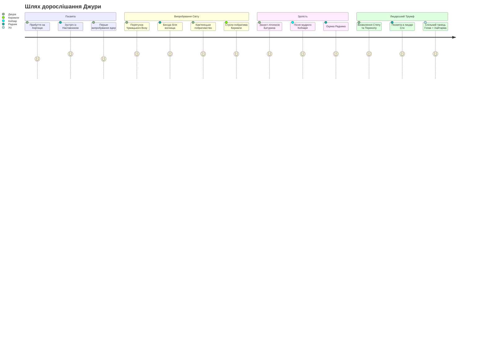
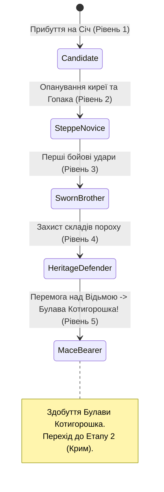
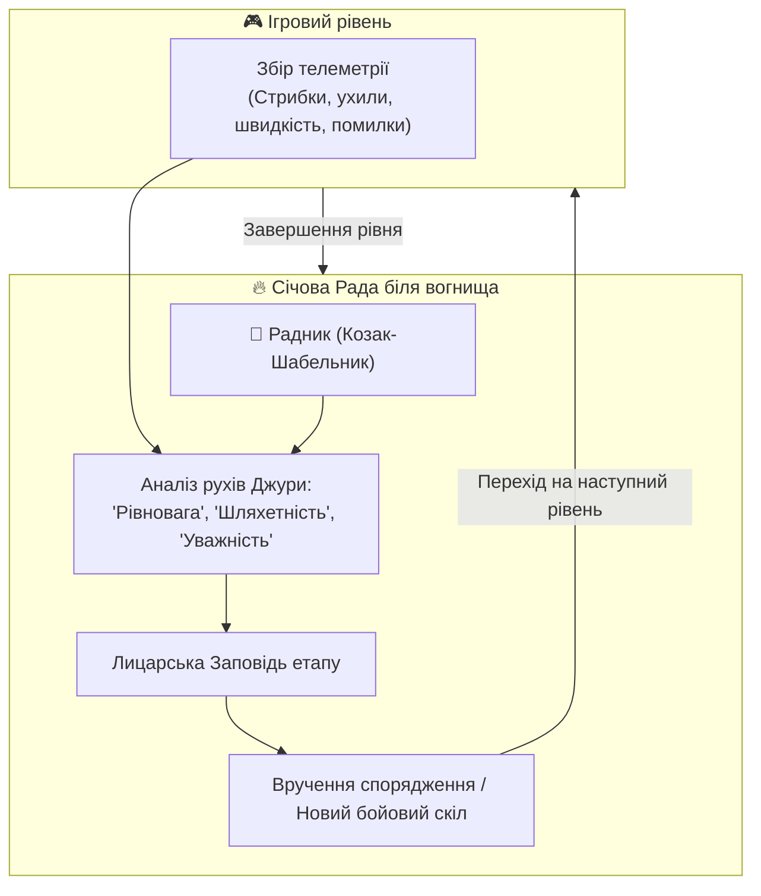
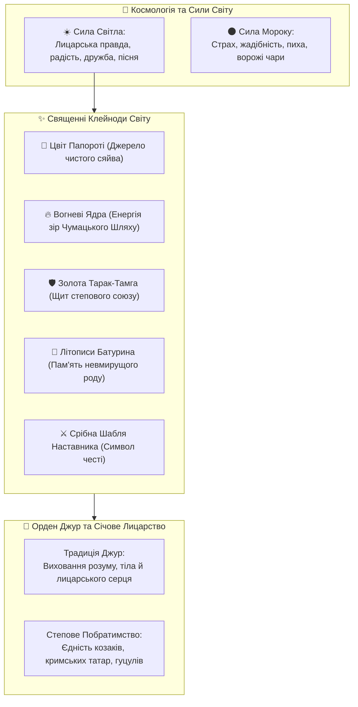
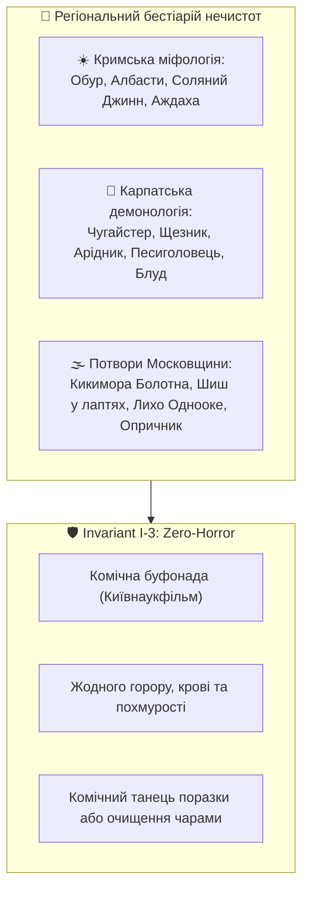
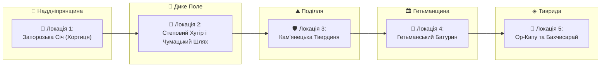
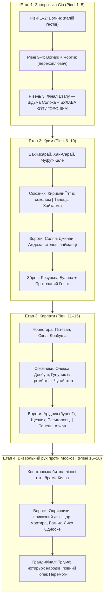
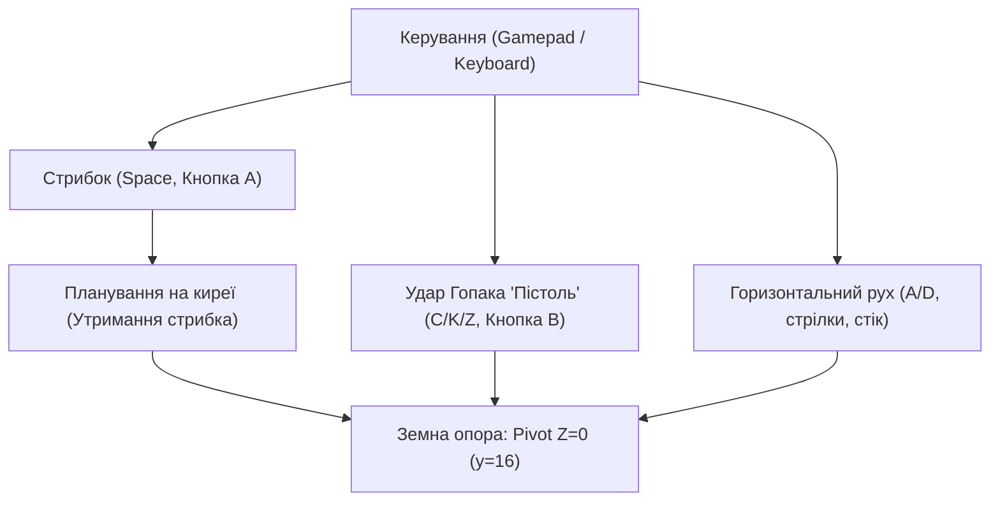

# GAME DESIGN DOCUMENT  
## Джура: початок шляху козака (Djura: Path of the Cossack)

**Жанр:** Однокористувацький героїчний фольклорний платформер / аркадний екшн (2.5D Folklore Platformer)  
**Платформа:** PC (Linux / Steam Deck / Windows), Web (HTML5 / WebAssembly)  
**Цільова аудиторія:** 8–14 років та сімейний геймінг  
**Версія документа:** Draft 1.1  
**Статус:** Active Development  

---

## Призначення документа

Цей документ описує ігрову концепцію, сценарну основу, **глибинний лор (Lore)**, ролі персонажів, базові правила, систему наставництва та ключові механіки гри **«Джура: початок шляху козака»**.

Game Design Document призначений для:
- геймдизайнера
- сценариста та автора лору
- художників та 3D-моделлерів
- технічної команди рушія Godot
- подальшої деталізації в **Technical Design Document (TDD)**, [**Gameplay Document (`docs/GAMEPLAY.md`)**](GAMEPLAY.md) та **Lore Document**

Документ є живим каноном проєкту і доповнюється у процесі розробки.

---

# 1. ЗАГАЛЬНА КОНЦЕПЦІЯ

**«Джура: початок шляху козака»** — це героїчна козацька казка-пригода про юного 15-річного хлопця, який прибув на Запорозьку Січ, щоб загартувати волю, пізнати мудрість лицарського кодексу та стати справжнім козаком.

Гравець керує Джурою, який під пильним оком свого **Радника (Козака-Наставника)** проходить 5 великих випробувань на землях України — від скель Хортиці через зоряний Чумацький Шлях, Кам'янецьку твердиню, гетьманський Батурин аж до Бахчисарая та воріт Перекопу.

Гра **не є історією про криваву війну чи знищення**.  
Вона зосереджена на:
- спритності та володінні власним тілом (козацький паркур, ширяння на киреї);
- лицарській шляхетності та взаємодопомозі (побратимство з кримськотатарськими та гуцульськими юнаками);
- захисті мирних трудівників та духовної спадщини предків;
- силі народного гумору, який висміює і розсіює будь-яку нечисту силу (Zero-Horror Invariant).

Ключова фантазія гравця:
> *Ти — юний джура.  
> Твій шлях — це не руйнування, а лицарське гартування духу, побратимство та перемога світла над темрявою.*

### Шлях гравця (Player Journey)

---

# 2. ПЕРСОНАЖ ГРАВЦЯ (PLAYER CHARACTER — ДЖУРА)

Гравець керує одним персонажем — **Джурою**, 15-річним юнаком-кандидатом у лицарі Низового Запорозького Війська, який є **таємним носієм прадавньої сили богатиря Котигорошка**.

### 2.1. Епічна спадщина Котигорошка та арка зброї
1. **Прихована богатирська сила:** Джура — на вигляд звичайний худий підліток у полотняній сорочці. Проте в його жилах тече кров богатирського роду Котигорошка. Сила предка спить у юнакові й пробуджується у відповідь на смертельну небезпеку для рідної землі та Запорозької Січі.
2. **Арка зброї (Weapon Progression Arc):**
   - **Етап 1 (Рівні 1–5):** Бій **виключно голими руками й ногами (Бойовий Гопак)**. Ніякої холодної зброї на старті. Джура доводить чистоту своєї майстерності, швидкість та гартування духу через автентичні прийоми:
     - прямий сталевий джеб кулаком;
     - високий стрибковий удар ногою **«Тинок»**;
     - низька коса підсічка **«Повзунець»**;
     - повітряний шпагатний удар **«Щупак / Розніжка»**.
   - **Прокачування сили рук і ніг:** З кожним рівнем ударна сила юнака зростає (+15% до швидкості удару, збільшення радіуса ураження та сили відкидання ворогів `knockback`).
3. **Кульмінація 1-го Етапу (Рівень 5) — Здобуття Булави Котигорошка:**
   - Після розсіювання чарів Відьми Солохи та порятунку Січі старий дуб відкриває потаємну схованку. Джура бере до рук реліквію — **Булаву Котигорошка**.
4. **Механіка ресурсної Булави (Durability & Weight):**
   - **Нищівна міць:** Булава розбиває ворогів з одного удару, збиває магічні снаряди й створює локальну сейсмічну хвилю на помості.
   - **Зношуваність (Міцність):** Булава має обмежений запас міцності (наприклад, 12–15 нищівних ударів). Гравець використовує її тактично у найтяжчі моменти.
   - **Злам та цикл повернення:** Після вичерпання міцності булава розсипається на золоті іскри. Джура повертається до свого прокачаного Бойового Гопака, поки на наступних етапах не знайде новий важкий козацький обушок або келеп.

### 2.2. Глобальні стани розвитку Джури

| Стан | Опис статусу | Відкриті навички та зброя |
| :--- | :--- | :--- |
| **Candidate (Кандидат)** | Новачок на помостах Січі (Рівень 1) | Базовий стрибок, баланс, гасіння бомб, кулачний джеб |
| **Steppe Novice (Степовик)** | Учень ширяння на киреї (Рівень 2) | Планерування киреєю, паркурний перекат (Roll) |
| **Sworn Brother (Побратим)** | Захисник порохових ярусів (Рівень 3) | Бойовий удар «Тинок», підсічка «Повзунець» проти Чортиків |
| **Heritage Defender (Охоронець)** | Спритний вартовий Січі (Рівень 4) | Повітряна розніжка «Щупак», стійкість до ударів |
| **Mace Bearer (Володар Булави)** | Переможець Відьми Солохи (Рівень 5) | **Прадавня Булава Котигорошка**, повний Переможний Гопак |

### 2.3. Роль персонажа
- **Вік:** 15 років (юнацька гнучка статура, спритний, допитливий, кмітливий).
- **Зовнішній вигляд:** Біла полотняна вишиванка з традиційним геометричним орнаментом на комірі-стійці, широкий червоний шовковий пояс (кояс) із золотою китицею на стегні, просторі кобальтові шаровари зі складками, м'які сап'янці-чоботи та хвацький оселедець (чуб).
- **3D-актив проєкту:** `assets/models/djura_meshy.glb` / `assets/models/djura_meshy.blend` (403k полігонів, PBR текстура, реконструйована з 360° концепт-арту Gemini).

---

# 3. РАДНИК ТА АРХІТЕКТУРА НАСТАВНИЦТВА (ADVISOR & MENTORSHIP)

Центральною сценарною та педагогічною віссю гри є стосунки між молодим Джурою та його **Радником (Козаком-Наставником)**.

### 3.1. Образ Радника (Козак-Шабельник)
* **Статус:** Досвідчений січовий характерник, ветеран походів, наставник молоді Хортицького куреня.
* **Характер:** Мудрий, доброзичливий, вимогливий, але сповнений батьківського гумору. Він не карає за невдалі спроби, а пояснює фізику та лицарську філософію руху.
* **Візуальний канон:** Поважна лицарська постава, сиві козацькі вуса, бойовий жупан, срібна козацька шабля при боці, теплий погляд з-під густих брів.
* **3D-актив проєкту:** `assets/models/mentor_cossack.glb` / `assets/models/mentor_cossack.blend` (50 МБ).

### 3.2. Механіка міжрівневої бесіди (Campfire Mentorship)
Між рівнями гра переходить у режим сюжетного перепочинку (`scripts/story_cards.gd`):
1. **Зворотний зв'язок на основі стилю гравця:**
   - Якщо гравець діяв необачно: *«Гаряче серце — це добре, Джуро, але шабля любить холодну голову. Не поспішай на багнет — пролітай над ним на киреї!»*
   - Якщо гравець часто користувався ухилами: *«Бачу, ухиляєшся легко, мов сокіл у степу! Такий козак ворога без бою зморить!»*
2. **Лицарський Кодекс (Сценарні тези дорослішання):**
   - *Урок 1 (Рівновага):* «Козак починається з землі. Тримай твердо підошви на дошках, відчувай центр ваги!»
   - *Урок 2 (Служіння):* «Лицарська шабля кується не для чванства, а для захисту того, хто оре ниву й возить сіль».
   - *Урок 3 (Побратимство):* «У степу немає чужої правди: хто стоїть поруч плечем до плеча — той тобі рідний брат».
   - *Урок 4 (Духовна скарбниця):* «Можна відбудувати спалений курінь, але втрачене слово й забуту пісню предків не повернути ні за яке золото».
   - *Урок 5 (Справжня перемога):* «Перемога — це коли після бою лунає не плач, а спільна пісня вільних людей».

---

# 4. 📖 ЛОР ТА СВІТОБУДОВА (LORE & WORLD-BUILDING)

Лор гри спирається на глибинний пласт українського лицарського епосу, козацьких переказів, міфології та побратимства народів степового Причорномор'я.

## 4.1. Епоха та історико-фольклорний контекст
Події відбуваються в казково-історичну добу розквіту Запорозької Січі. Це простір, де історичні реалії (курені Хортиці, гетьманські фортеці, чумацькі валки, кам'янецькі мури) органічно переплітаються з живою українською демонологією Гоголя та народною магією.

Світ тримається на **Рівновазі Світла й Землі**:
- Доки козаки стоять на варті правди, а чумаки возять сіль під зорями — над степом панує мир і достаток.
- Коли ж із темних боліт та чужих імперій підкрадається злодійська заздрість — дрібна нечисть (чортики, перевертні, відьми) намагається викрасти зорі, загасити вогні на Січі та посіяти між людьми ворожнечу.

## 4.2. Інститут Джур: хто такий джура за козацьким звичаєм
Запорозький **джура** (від давнього персько-тюркського *yoldash / jura* — вірний супутник, побратим) — це не слуга і не зброєносець. Це юнак, обраний старим козаком за чистоту серця та допитливий розум:
- Наставник навчає джуру **семи лицарським умінням**:
  1. *Грамоті та літописанню* — щоб знати історію свого народу;
  2. *Травознавству та плаванню* — щоб виживати в плавнях;
  3. *Верховій їзді та орієнтуванню за зорями*;
  4. *Ширянню на вітрі* за допомогою козацької киреї;
  5. *Бойовому Гопаку* — володінню тілом як зброєю;
  6. *Характерництву* — невразливості до навіювань ворожого страху;
  7. *Лицарській вірності слову* — понад усе на світі.

## 4.3. Характерництво та природа магії у грі
Магія у грі позбавлена окультного чи похмурого змісту — це **радісна народна магія гармонії з природою**:
- **Кирея-планер (Крила лицаря):** виткана з особливого січового шовку, просоченого степовим воском. При стрибку ловить повітряні потоки, наче вітрило чайки.
- **Оморока характерника:** уміння напустити на ворога кумедний туман, через який нападники бачать замість козака високу ковилу чи вербову колоду, починають сваритися між собою і губити постоли.
- **Цвіт Папороті:** розквітає лише перед тим, хто має чисті помисли. Його спалах випромінює тепле сонячне світло, яке миттєво повертає переляканих чортиків у їхній природний вигляд маленьких жабенят або цвіркунів.

## 4.4. Священні Реліквії (Клейноди)
1. **Вогневі Ядра Перемоги:** викувані з небесної міді запорозькими ковалями. Живлять фортечні гармати для святкових салютів і служать маяками для нічних подорожніх.
2. **Золота Тарак-Тамга (Герб Побратимства):** священний знак кримськотатарських володарів, подарований козакам на знак вічного миру. Дає захисний ореол від підступних уколів.
3. **Літописна Книга Батурина:** писана золотом на пергаменті, містить козацькі конституційні закони волі та пісні Кобзарів.
4. **Срібна Шабля Наставника:** викувана старими майстрами з метеоритного заліза, вона ніколи не б'є беззбройного і світиться м'яким блакитним сяйвом, вказуючи джурі правильний шлях.

## 4.5. Степове Побратимство (Козаки, Киримли, Гуцули)
Лор гри акцентує на історичній правді спільного сусідства та взаємоповаги:
- **Кримськотатарські побратими (Qırımlılar):** благородні степові лицарі, неперевершені лучники та захисники вільного кримського неба. Юний Киримли Yigit (14–15 років, ровесник Джури) виступає вірним союзником у боротьбі проти загарбників.
- **Карпатські легіні (Гуцули):** володарі гірських перевалів, майстри топірця-бартки та пісень-коломийок. Юний Гуцулик-легінь (14–15 років) прикриває побратимів у найгарячіших сутичках.

## 4.6. 👹 Регіональний бестіарій та фольклорні нечистоти (Крим, Карпати, Московщина)

Для збагачення ігрового розмаїття та автентичного колориту на наступних рівнях кампанії введено автентичних фольклорних ворогів та нейтральних міфічних істот із трьох ключових регіонів:

> [!TIP]
> Повний опис взаємодії нечистот із бойовими механіками, стрибками та артефактами (Черевички Вакули, Цвіт Папороті, запалені ядра, бали) зафіксовано у спеціалізованому [**Документі геймплею (`docs/GAMEPLAY.md`)**](GAMEPLAY.md#4-регіональний-бестіарій-та-міфологічні-нечистоти-у-геймплеї).

### 1. Кримські нечистоти та міфічні істоти (Таврида / Кримський Юрт)
* **Обур (Obur / Степовий Ненажера-Вихор):**
  - *Образ:* Хитрий кудлатий степовий перевертень, що перетворюється на вихор перекотиполя, ганяє по арені, підіймає куряву й намагається проковтнути або заховати вогневі ядра у свій глиняний глечик.
  - *Геймплей:* Швидкий рух зиґзаґом; при наближенні Джури випускає хмару пилу. Влучний удар ногою розбиває глечик, повертаючи ядра, а сам Обур кумедно котиться геть.
* **Албасти (Albastı / Гірська Імлиця Чуфут-Кале):**
  - *Образ:* Підступна духаниця печерних урвищ у довгому напівпрозорому серпанку, що насилає густий сонний туман на високі карнизи.
  - *Геймплей:* Завішує платформи м'якою пеленою, змушуючи Джуру стрибати на звук або кликати сокола Киримли, який розганяє імлу крилами.
* **Соляний Джинн Сиваша (Cin / Şeytan солончаків):**
  - *Образ:* Маленький іскристий бісик із білої кристалічної солі, що вистрибує із солончакових вибоїн і кидається грудочками солі, які тимчасово роблять платформи слизькими.
* **Печерний Аждаха (Ejderha Ай-Петрі):**
  - *Образ:* Невеликий добродушний товстенький дракончик із крильцями кажана, що живе в гротах і стереже давні монети; кумедно чмихає кільцями теплого диму.

### 2. Карпатські нечистоти та лісові духи (Чорногора / Гуцульщина)
* **Чугайстер (Лісовий Велетень Чорногори):**
  - *Образ:* Веселий велетень у білому одязі з кори смереки та ялинового гілля, що блукає полонинами, грає на денцівці й шукає, з ким би потанцювати.
  - *Геймплей:* Нейтральний / небезпечний танцюрист: коли Чугайстер починає відбивати шалену гуцулку, усі навколо (Джура, вороги, чортики) починають мимоволі пританцьовувати! Щоб пройти повз, треба вчасно натискати ритмічні кнопки Гопака.
* **Щезник (Гірський Дідько-пустун):**
  - *Образ:* Волохатий карпатський чортик у баранячій шапці-клепані та веретяних постолах, що раптово з'являється і зникає («щезає») з гучним хлопком і синім димком.
  - *Геймплей:* Телепортується між помостами, дражниться язиком і переставляє ядра місцями.
* **Карпатський Блуд (Блудниця Полонинська):**
  - *Образ:* Мерехтливий блукаючий вогник, що зависає в повітрі; якщо Джура врізається в нього в польоті, керування рухом ліворуч/праворуч на 3 секунди інвертується («заблукав між смерек!»).
* **Песиголовець (Псоглавець диких перевалів):**
  - *Образ:* Незграбний комічний велетень із вовчою мордою у грубій овечій шкурі, що гупає важкими ногами й котить з верхніх ярусів дерев'яні колоди.
* **Арідник (Прабіс гірських гроз):**
  - *Образ:* Сивий карпатський володар громовиць, що сидить на шпилі гори Піп-Іван і насилає на арену блискавки та пориви гірського вітру.

### 3. Московські потвори та болотна нечисть (Залісся / Північні болота)
* **Шиш Болотний (Шишок / Шишига в лаптях):**
  - *Образ:* Горбатий мародер у дірявому драному сіряку та мокрих ликових лаптях із болотяного моху; нишпорить під помостами, намагаючись поцупити козацький порох і заховати в твань.
  - *Геймплей:* Ховається під дошками; при наближенні кидає ликовий лапоть, який можна відбити ударом чобота.
* **Кикимора Заліська (Кикимора Болотна):**
  - *Образ:* Вередлива худорлява баба з баговиння та жабуриння з кікіморячим дзьобом; сидить на стельових балках, верещить, плюється багном і сплутує канати підвісних мостів.
  - *Геймплей:* Обплітає платформи тванню, сповільнюючи біг; збивається ударом з неба (комбо Сокола або бартка Гуцула).
* **Лихо Однооке:**
  - *Образ:* Височезне кощаве створіння в лахмітті з одним величезним немигаючим оком посеред лоба; уособлення злиднів і жадібності царя.
  - *Геймплей:* Насилає промінь розгубленості; гасить запалені ядра. Щоб здолати Лихо, треба засліпити його сонячним спалахом Цвіту Папороті.
* **Царський Приказний Дяк-Крючкотвор:**
  - *Образ:* Сутулий чинуша у довжелезних рукавах до землі з безкінечним сувоєм указу й гусячим пером; бігає за героями, вимагаючи «сплатити мито за повітря».
* **Опричний Пес (Каратель на мортирі):**
  - *Образ:* Броньований вершник у чорному жупані з мітлою та відсіченою вовчою головою; служить особистою охороною пихатого Воєводи.

---

# 5. ОГЛЯД ІГРОВОГО СВІТУ (WORLD OVERVIEW)

## 5.1. Локації гри

### Локація 1: Запорозька Січ на Хортиці
- **Атмосфера:** Сонячний день над Дніпровими кручами, дубові курені, частокіл, фортечні кулеврини, порохові погреби.
- **Головна мета:** Зібрати розкидані бешкетними чортиками порохові ядра на високих помостах до святкового салюту.

### Локація 2: Степовий Хутір та Чумацький Шлях
- **Атмосфера:** Зоряна українська ніч, вітряки, білі мазанки під солом'яними стріхами, мальви, чумацький обоз із волами.
- **Головна мета:** Пройти вітряками та стріхами, запалити світлом вогняних ядер Чумацький Шлях і прогнати Нічну Відьму Солоху.

### Локація 3: Кам'янецька Твердиня
- **Атмосфера:** Величний каньйон річки Смотрич, стародавні кам'яні мури, високі стрільчасті вежі, склепіння брам.
- **Головна мета:** Допомогти побратиму Киримли відбити арсенал у царських солдатів-мародерів Меншикова, оминаючи гострі багнети.

### Локація 4: Гетьманський Батурин
- **Атмосфера:** Золота гетьманська столиця, барокові дзвіниці, дерев'яна скарбниця, бібліотека літописів.
- **Головна мета:** Під супровід пісні старого Кобзаря загасити ворожі підпали та зберегти гетьманські клейноди.

### Локація 5: Ор-Капу та Бахчисарай (Гранд-Фінал)
- **Атмосфера:** Білі брами Перекопу, квітучий Бахчисарай, фонтани, відкритий вільний степовий простір.
- **Головна мета:** Фінальне лицарське випробування — поєднати козацький Бойовий Гопак та кримськотатарську Хайтарму у спільному святі Перемоги.

## 5.2. Чотири канонічні регіонально-фольклорні Етапи кампанії (4 Acts × 5 Levels = 20 Levels)

Кампанія гри суворо структурована на 4 великі географічні та культурно-фольклорні Етапи по 5 рівнів кожен. Кожен етап має власну автентичну атмосферу, музику, бестіарій та коло союзників, без змішування культур:

1. **Етап 1: Запорозька Січ (Рівні 1–5, Суто український козацький фольклор):**
   - **Сюжет:** 15-річний хлопець просить Характерника взяти його за Джуру. Нечисть мінує Січ; хлопець проходить іспит наставництва.
   - **Бестіарій та крива випробувань:**
     - *Рівні 1–2:* Лише **Вогник** (активний палій ґнотів). Освоєння бігу, стрибків і перехоплення підпалених ядер.
     - *Рівні 3–4:* Додається **Чортик** (+2 рівні). Перше застосування ударів Бойового Гопака («Тинок», «Повзунець»).
     - *Рівень 5 (Кульмінація):* Прилітає **Відьма Солоха** на мітлі (+2 рівні). Порятунок Січі.
   - **Зброя:** Виключно руки й ноги (Бойовий Гопак).
   - **Нагорода фіналу 1-го Етапу:** Здобуття прадавньої **Булави Котигорошка**.
   - **Союзники:** Жодних сторонніх союзників. Джура доводить усе самостійно перед Наставником.

2. **Етап 2: Крим (Рівні 6–10, Кримськотатарський фольклор):**
   - **Сюжет:** Відступаюча нечисть біжить на Південь; Джура прямує до Криму на допомогу степовим побратимам.
   - **Локації:** Брама Ор-Капу (Перекоп), Ханський палац у Бахчисараї, скелі Чуфут-Кале.
   - **Союзник:** Юний **Киримли Їгіт** із бойовим соколом.
   - **Вороги:** Соляні Джинни із Сиваша, печерний дракончик Аждаха, ординські диверсанти.
   - **Зброя:** Булава Котигорошка (ресурсна міцність) + прокачаний Гопак.
   - **Музика та танець:** Степова **Хайтарма**.

3. **Етап 3: Карпати (Рівні 11–15, Гуцульський та верховинський фольклор):**
   - **Сюжет:** Нечисть шукає прихистку в непролазних карпатських пралісах та грозових верхів'ях.
   - **Локації:** Вершина гори Піп-Іван, Скелі Довбуша, полонини Чорногори.
   - **Союзники:** Легендарний ватажок **Олекса Довбуш** із золотою барткою, юний пастушок **Гуцулик** із трембітою, велетень **Чугайстер**.
   - **Вороги:** Злий дух громовиць Арідник, лісовий Щезник, дикі Песиголовці.
   - **Музика та танець:** Ритуальний гуцульський танець **Аркан**.

4. **Етап 4: Визвольний рух проти Московії (Рівні 16–20, Визвольний епос):**
   - **Сюжет:** Викриття головного кубла темряви — загарбницької орди з боліт Залісся, що прагне знищити волю всіх вільних народів.
   - **Локації:** Соснівські болота під Конотопом, давні літописні фортеці, Золоті Ворота Києва.
   - **Вороги:** Царські опричники з мітлами, приказний дяк із безкінечним сувоєм податей, чавунна Цар-мортира, Лісовий Багник, Лихо Однооке.
   - **Фінал:** Тріумфальний розгром ворога об'єднаними силами українців, кримців, гуцулів та литвинів. Свято Перемоги.

---

# 6. БАЗОВІ ІГРОВІ ПРАВИЛА ТА МЕХАНІКИ (CORE GAMEPLAY)

### 6.1. Рух та козацький паркур
- **Ширяння на киреї (Cossack Glide):** Утримуючи кнопку стрибка під час спуску, Джура розправляє поли двосторонньої шовкової киреї. Горизонтальна швидкість зберігається, а вертикальне падіння сповільнюється у 3 рази, дозволяючи долати широкі прірви між помостами.
- **Стрибки крізь балки знизу вгору:** Завдяки підківкам коваля Вакули гравець може прострибувати крізь дерев'яні помісти знизу, але при приземленні зверху платформа стає надійною твердою опорою.
- **Правило твердої стелі:** При ударі головою об кам'яне склепіння (Кам'янець) вертикальна швидкість гаситься без штрафного оглушення (smooth sliding).

### 6.2. Бойовий Гопак (Hopak Combat Arts)
- **Удар ногою «Пістоль» (Hopak Kick):** Виконується з присядки або в повітрі. Джура різко викидає вперед п'яту з козацьким вигуком «Гей!». Удар розбиває ворожі перешкоди та збиває пиху з ворогів.
- **Ухил та човник (Usyk Footwork):** Швидке зміщення на півкорпусу назад або вбік з нульовим часом відновлення, що рятує від ворожих снарядів.

### 6.3. Ключові інваріанти фізики
- **Інваріант I-4 (Anti-Clipping Ground Pivot):** Усі спрайти та 3D-моделі мають точку прив'язки на підошвах чобіт ($Z = 0$, $y = 16$). Пробивання текстур підлоги строго заборонено математичними обмеженнями колайдера ($18 \times 38$ px).

### 6.4. Динамічна фізика поверхонь та тимчасові дебафи від нечистот (Dynamic Platform Hazards)
- **Платформи з нахилом ($\pm 10^\circ \dots 25^\circ$):** додають тангенціальне прискорення ковзання, що прискорює рух униз для суперстрибків або вимагає зусиль при бігу вгору.
- **Слизькість та зледеніння (Солончаки Криму / Карпатська крига):** тертя падає до $\mu = 0.15$, виникає ковзання і потрійний гальмівний шлях.
- **В'язкі поверхні (Сипучий пісок / Болотна твань Московії):** гальмують швидкість Джури на $40\%$, зменшують стрибок на $30\%$ та блокують перекати.
- **Тимчасова шкода та дебафи від нечистот:**
  - *Соляний Джинн:* створює соляну кірку на балці (слизькість на 6с).
  - *Кикимора Болотна:* обпльовує балки тванню (уповільнення на 4с).
  - *Арідник / Лихо:* крижаний іній на помості (замерзання на 5с).
  - *Шиш у лаптях:* налипання липкої глини на постоли героя (зниження стрибка на 3с).
Деталізовані формули та матрицю взаємодії наведено у [**docs/GAMEPLAY.md §5**](GAMEPLAY.md#5-фізика-інтерактивних-платформ-та-динамічні-модифікатори-поверхонь).

---

# 7. СИСТЕМА ПРОГРЕСІЇ ТА АДАПТИВНОСТІ (PERSISTENCE & FLOW)

## 7.1. Адаптивна складність (Bayesian Flow Adaptation — SHR-003)
Система телеметрії оцінює 4 ключові метрики проходження рівня:
1. `jump_success_rate` — частка вдалих приземлень на платформи.
2. `reaction_time` — швидкість реакції на рух ворогів.
3. `glide_efficiency` — правильність використання киреї при широких стрибках.
4. `perseverance` — кількість спроб без виходу з гри.

На основі байєсівської оцінки рушій непомітно для дитини коригує швидкість ворогів (коефіцієнт $k_{\text{diff}} \in [0.75, 1.35]$), забезпечуючи стан психологічного комфорту та творчого потоку (Flow State).

## 7.2. Збереження прогресу
- Зберігається статус пройдених рівнів, знайдені козацькі клейноди та оцінки Наставника.
- Гра автоматично зберігає прогрес після кожного завершення сцени «Рада біля вогнища».

---

# 8. ТЕМИ ТА АТМОСФЕРА (THEMES & ATMOSPHERE)

## 8.1. Основні теми
- **Лицарська честь і наставництво:** Повага до досвіду старших, вміння слухати поради та вчитися на помилках.
- **Побратимство культур:** Єдність українських козаків, кримськотатарських вершників та гуцульських опришків як непорушний щит свободи.
- **Любов до рідної землі:** Захист чумаків, хліборобів, пошана до козацьких літописів і пісень предків.
- **Світло проти мороку:** Добродушний сміх і козацька пісня розвіюють будь-які чари страху.

## 8.2. Аудіовізуальна атмосфера
- **Візуальний стиль:** Соковиті теплі барви українського літа, золоті степи, гуашеві текстури хат-мазанок, синій кобальт Дніпра та шароварів, білосніжні вишиванки.
- **Музика:** Живе звучання Троїстих Музик (кобза, бандура, цимбали, сопілка, бубон з тарілочками, дримба). Музичний ритм козачка ($2/4$) динамічно оживає під час стрибків і виконання комбо.

---

# 9. ПРИНЦИПИ ДИЗАЙНУ ТА ОБМЕЖЕННЯ

## 9.1. Принципи дизайну
1. **Зрозумілість для дитини від 8 років:** Кожен рівень містить рівно одну нову механіку та одного нового друга.
2. **Нуль жорстокості (Zero-Horror Invariant $I-3$):** Жодних поранень, крові чи пригнічуючих образів.
3. **Детермінізм правил (Invariant $I-1$):** Стрибок завжди має передбачувану висоту та параболу.
4. **Шанобливість до спадщини:** Усі елементи одягу, зброї та традицій відповідають історико-фольклорному канону.

---

# 10. ІДЕЇ ПОДАЛЬШОГО РОЗВИТКУ ГРИ (FUTURE IDEAS)

## 10.1. Кооперативне побратимство (2 гравці на одному екрані)
- Гравець 1: Джура (ближній бій, паркур, ширяння).
- Гравець 2: Киримли Yigit (дистанційний лук, виявлення прихованих скарбів) або Гуцул з топірцем-барткою.

## 10.2. Розширення наставництва
- Інтерактивні діалоги з Наставником із вибором козацьких відповідей на Січовій Раді.
- Міні-ігри на тренувальному майданчику Січі (стрільба в мішень, змагання на колоді).

---

# CHANGELOG

| Версія | Дата | Опис змін | Автор |
| :--- | :--- | :--- | :--- |
| **Draft 1.2** | 2026-10-25 | Закріплено 5-рівневу структуру сюжетних актів (Серія 1: Козацька Україна і Січ, Серія 2: Кримський похід, Серія 3: Карпатський шлях). Зафіксовано правила: Рівень 1 лише Джура і Вогник (+10% на рівні 2), вороги додаються через рівень, союзники з'являються виключно на фіналі кожної серії (рівні 5, 10, 15). Інтегровано механіку Вогника-каталізатора (60% підпал, таймер ґнота 7с, комічний «БАХ!», ланцюгова детонація). | Antigravity AI / Nick Fedchik |
| **Draft 1.1** | 2026-10-25 | Додано великий розділ 4 «ЛОР ТА СВІТОБУДОВА»: традиція інституту джур, природа характерництва, священні клейноди, космологія Світла/Мороку, степове побратимство з Киримли. | Antigravity AI / Nick Fedchik |
| **Draft 1.0** | 2026-10-25 | Перша канонічна редакція GDD за зразком CallOfRelics. Інтегровано образ Радника-Наставника, 5 сюжетних етапів, систему Campfire Mentorship та інваріанти I-1..I-5. | Antigravity AI / Nick Fedchik |
