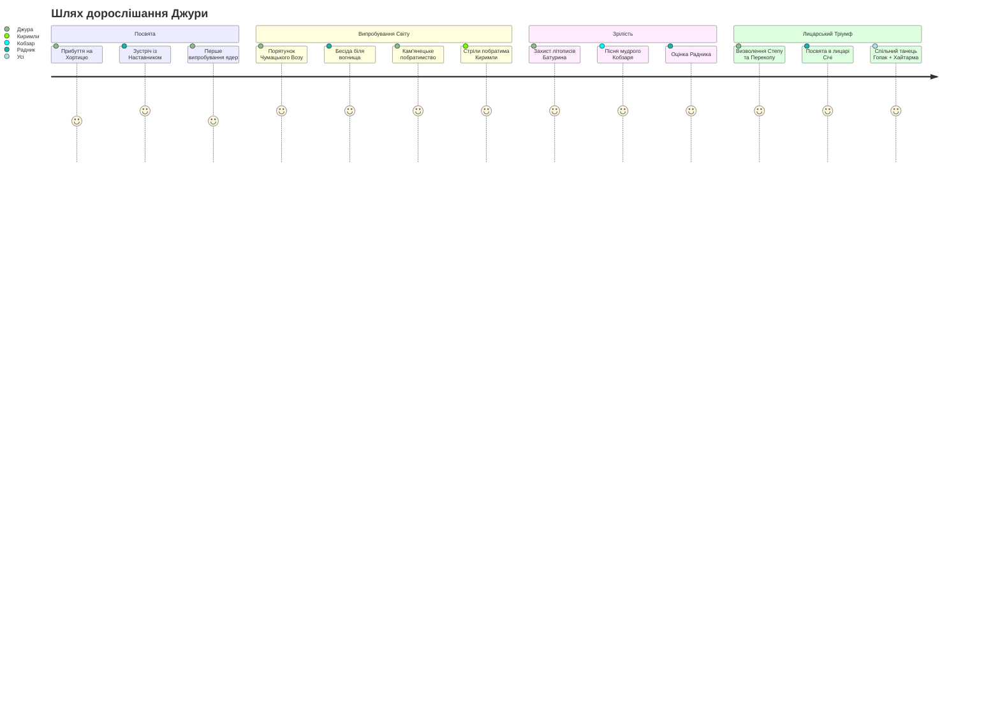
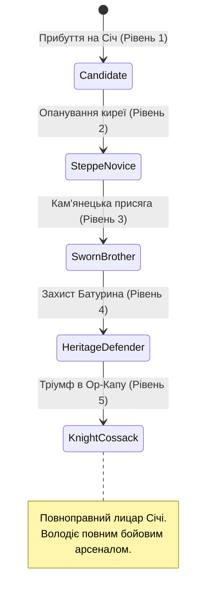
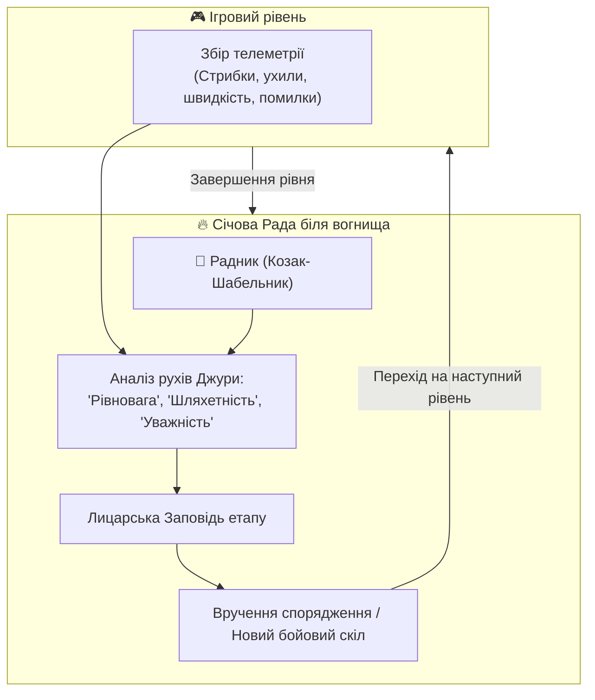
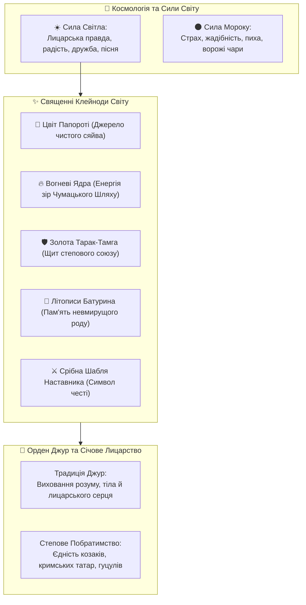
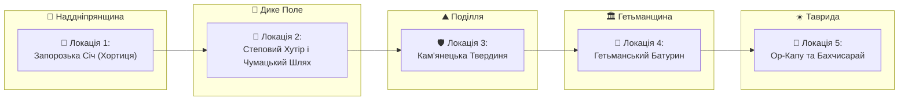
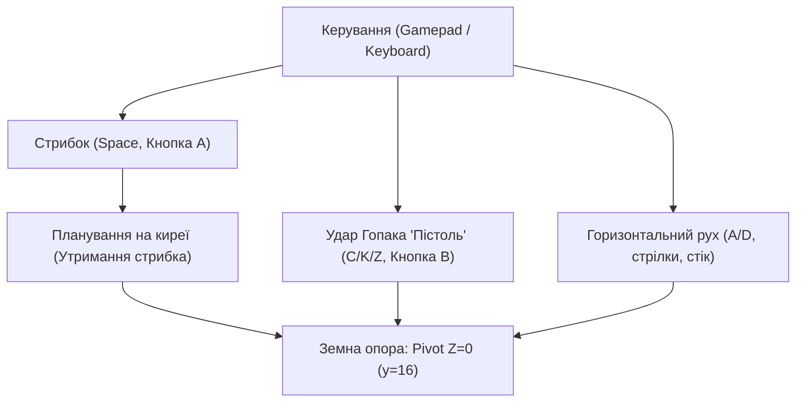

# GAME DESIGN DOCUMENT  
## Джура: початок шляху козака (Djura: Path of the Cossack)

**Жанр:** Однокористувацький героїчний фольклорний платформер / аркадний екшн (2.5D Folklore Platformer)  
**Платформа:** PC (Linux / Steam Deck / Windows), Web (HTML5 / WebAssembly)  
**Цільова аудиторія:** 8–14 років та сімейний геймінг  
**Версія документа:** Draft 1.1  
**Статус:** Active Development  

---

## Призначення документа

Цей документ описує ігрову концепцію, сценарну основу, **глибинний лор (Lore)**, ролі персонажів, базові правила, систему наставництва та ключові механіки гри **«Джура: початок шляху козака»**.

Game Design Document призначений для:
- геймдизайнера
- сценариста та автора лору
- художників та 3D-моделлерів
- технічної команди рушія Godot
- подальшої деталізації в **Technical Design Document (TDD)** та **Lore Document**

Документ є живим каноном проєкту і доповнюється у процесі розробки.

---

# 1. ЗАГАЛЬНА КОНЦЕПЦІЯ

**«Джура: початок шляху козака»** — це героїчна козацька казка-пригода про юного 15-річного хлопця, який прибув на Запорозьку Січ, щоб загартувати волю, пізнати мудрість лицарського кодексу та стати справжнім козаком.

Гравець керує Джурою, який під пильним оком свого **Радника (Козака-Наставника)** проходить 5 великих випробувань на землях України — від скель Хортиці через зоряний Чумацький Шлях, Кам'янецьку твердиню, гетьманський Батурин аж до Бахчисарая та воріт Перекопу.

Гра **не є історією про криваву війну чи знищення**.  
Вона зосереджена на:
- спритності та володінні власним тілом (козацький паркур, ширяння на киреї);
- лицарській шляхетності та взаємодопомозі (побратимство з кримськотатарськими та гуцульськими юнаками);
- захисті мирних трудівників та духовної спадщини предків;
- силі народного гумору, який висміює і розсіює будь-яку нечисту силу (Zero-Horror Invariant).

Ключова фантазія гравця:
> *Ти — юний джура.  
> Твій шлях — це не руйнування, а лицарське гартування духу, побратимство та перемога світла над темрявою.*

### Шлях гравця (Player Journey)

---

# 2. ПЕРСОНАЖ ГРАВЦЯ (PLAYER CHARACTER — ДЖУРА)

Гравець керує одним персонажем — **Джурою**, 15-річним юнаком-кандидатом у лицарі Низового Запорозького Війська.

### Глобальні стани розвитку Джури

| Стан | Опис статусу | Відкриті навички |
| :--- | :--- | :--- |
| **Candidate (Кандидат)** | Новачок на помостах Хортиці | Базовий стрибок, баланс, перше ширяння |
| **Steppe Novice (Степовик)** | Захисник чумаків у нічному степу | Золоті підківки Вакули, стрибок крізь балки |
| **Sworn Brother (Побратим)** | Захисник Кам'янецької твердині | Ухил і човник Усика, щит Тарак-Тамга |
| **Heritage Defender (Охоронець)** | Оборонець клейнодів Батурина | Сяйво Кобзаря, стійкість до ворожих чар |
| **Knight Cossack (Лицар Січі)** | Визнаний повноправний побратим | Вогняний Бойовий Гопак «Пістоль», тріумф |

### Роль персонажа
- **Вік:** 15 років (юнацька гнучка статура, спритний, допитливий, кмітливий).
- **Зовнішній вигляд:** Біла полотняна вишиванка з традиційним геометричним орнаментом на комірі-стійці, широкий червоний шовковий пояс (кояс) із золотою китицею на стегні, просторі кобальтові шаровари зі складками, м'які сап'янці-чоботи та хвацький оселедець (чуб).
- **3D-актив проєкту:** `assets/models/djura_meshy.glb` / `assets/models/djura_meshy.blend` (403k полігонів, PBR текстура, реконструйована з 360° концепт-арту Gemini).

---

# 3. РАДНИК ТА АРХІТЕКТУРА НАСТАВНИЦТВА (ADVISOR & MENTORSHIP)

Центральною сценарною та педагогічною віссю гри є стосунки між молодим Джурою та його **Радником (Козаком-Наставником)**.

### 3.1. Образ Радника (Козак-Шабельник)
* **Статус:** Досвідчений січовий характерник, ветеран походів, наставник молоді Хортицького куреня.
* **Характер:** Мудрий, доброзичливий, вимогливий, але сповнений батьківського гумору. Він не карає за невдалі спроби, а пояснює фізику та лицарську філософію руху.
* **Візуальний канон:** Поважна лицарська постава, сиві козацькі вуса, бойовий жупан, срібна козацька шабля при боці, теплий погляд з-під густих брів.
* **3D-актив проєкту:** `assets/models/mentor_cossack.glb` / `assets/models/mentor_cossack.blend` (50 МБ).

### 3.2. Механіка міжрівневої бесіди (Campfire Mentorship)
Між рівнями гра переходить у режим сюжетного перепочинку (`scripts/story_cards.gd`):
1. **Зворотний зв'язок на основі стилю гравця:**
   - Якщо гравець діяв необачно: *«Гаряче серце — це добре, Джуро, але шабля любить холодну голову. Не поспішай на багнет — пролітай над ним на киреї!»*
   - Якщо гравець часто користувався ухилами: *«Бачу, ухиляєшся легко, мов сокіл у степу! Такий козак ворога без бою зморить!»*
2. **Лицарський Кодекс (Сценарні тези дорослішання):**
   - *Урок 1 (Рівновага):* «Козак починається з землі. Тримай твердо підошви на дошках, відчувай центр ваги!»
   - *Урок 2 (Служіння):* «Лицарська шабля кується не для чванства, а для захисту того, хто оре ниву й возить сіль».
   - *Урок 3 (Побратимство):* «У степу немає чужої правди: хто стоїть поруч плечем до плеча — той тобі рідний брат».
   - *Урок 4 (Духовна скарбниця):* «Можна відбудувати спалений курінь, але втрачене слово й забуту пісню предків не повернути ні за яке золото».
   - *Урок 5 (Справжня перемога):* «Перемога — це коли після бою лунає не плач, а спільна пісня вільних людей».

---

# 4. 📖 ЛОР ТА СВІТОБУДОВА (LORE & WORLD-BUILDING)

Лор гри спирається на глибинний пласт українського лицарського епосу, козацьких переказів, міфології та побратимства народів степового Причорномор'я.

## 4.1. Епоха та історико-фольклорний контекст
Події відбуваються в казково-історичну добу розквіту Запорозької Січі. Це простір, де історичні реалії (курені Хортиці, гетьманські фортеці, чумацькі валки, кам'янецькі мури) органічно переплітаються з живою українською демонологією Гоголя та народною магією.

Світ тримається на **Рівновазі Світла й Землі**:
- Доки козаки стоять на варті правди, а чумаки возять сіль під зорями — над степом панує мир і достаток.
- Коли ж із темних боліт та чужих імперій підкрадається злодійська заздрість — дрібна нечисть (чортики, перевертні, відьми) намагається викрасти зорі, загасити вогні на Січі та посіяти між людьми ворожнечу.

## 4.2. Інститут Джур: хто такий джура за козацьким звичаєм
Запорозький **джура** (від давнього персько-тюркського *yoldash / jura* — вірний супутник, побратим) — це не слуга і не зброєносець. Це юнак, обраний старим козаком за чистоту серця та допитливий розум:
- Наставник навчає джуру **семи лицарським умінням**:
  1. *Грамоті та літописанню* — щоб знати історію свого народу;
  2. *Травознавству та плаванню* — щоб виживати в плавнях;
  3. *Верховій їзді та орієнтуванню за зорями*;
  4. *Ширянню на вітрі* за допомогою козацької киреї;
  5. *Бойовому Гопаку* — володінню тілом як зброєю;
  6. *Характерництву* — невразливості до навіювань ворожого страху;
  7. *Лицарській вірності слову* — понад усе на світі.

## 4.3. Характерництво та природа магії у грі
Магія у грі позбавлена окультного чи похмурого змісту — це **радісна народна магія гармонії з природою**:
- **Кирея-планер (Крила лицаря):** виткана з особливого січового шовку, просоченого степовим воском. При стрибку ловить повітряні потоки, наче вітрило чайки.
- **Оморока характерника:** уміння напустити на ворога кумедний туман, через який нападники бачать замість козака високу ковилу чи вербову колоду, починають сваритися між собою і губити постоли.
- **Цвіт Папороті:** розквітає лише перед тим, хто має чисті помисли. Його спалах випромінює тепле сонячне світло, яке миттєво повертає переляканих чортиків у їхній природний вигляд маленьких жабенят або цвіркунів.

## 4.4. Священні Реліквії (Клейноди)
1. **Вогневі Ядра Перемоги:** викувані з небесної міді запорозькими ковалями. Живлять фортечні гармати для святкових салютів і служать маяками для нічних подорожніх.
2. **Золота Тарак-Тамга (Герб Побратимства):** священний знак кримськотатарських володарів, подарований козакам на знак вічного миру. Дає захисний ореол від підступних уколів.
3. **Літописна Книга Батурина:** писана золотом на пергаменті, містить козацькі конституційні закони волі та пісні Кобзарів.
4. **Срібна Шабля Наставника:** викувана старими майстрами з метеоритного заліза, вона ніколи не б'є беззбройного і світиться м'яким блакитним сяйвом, вказуючи джурі правильний шлях.

## 4.5. Степове Побратимство (Козаки, Киримли, Гуцули)
Лор гри акцентує на історичній правді спільного сусідства та взаємоповаги:
- **Кримськотатарські побратими (Qırımlılar):** благородні степові лицарі, неперевершені лучники та захисники вільного кримського неба. Юний Киримли Yigit виступає вірним союзником Джури у боротьбі проти спільних загарбників.
- **Карпатські легіні (Гуцули):** володарі гірських перевалів, майстри топірця-бартки та пісень-коломийок, які допомагають козакам знаходити чарівні корені сили.

---

# 5. ОГЛЯД ІГРОВОГО СВІТУ (WORLD OVERVIEW)

## 5.1. Локації гри

### Локація 1: Запорозька Січ на Хортиці
- **Атмосфера:** Сонячний день над Дніпровими кручами, дубові курені, частокіл, фортечні кулеврини, порохові погреби.
- **Головна мета:** Зібрати розкидані бешкетними чортиками порохові ядра на високих помостах до святкового салюту.

### Локація 2: Степовий Хутір та Чумацький Шлях
- **Атмосфера:** Зоряна українська ніч, вітряки, білі мазанки під солом'яними стріхами, мальви, чумацький обоз із волами.
- **Головна мета:** Пройти вітряками та стріхами, запалити світлом вогняних ядер Чумацький Шлях і прогнати Нічну Відьму Солоху.

### Локація 3: Кам'янецька Твердиня
- **Атмосфера:** Величний каньйон річки Смотрич, стародавні кам'яні мури, високі стрільчасті вежі, склепіння брам.
- **Головна мета:** Допомогти побратиму Киримли відбити арсенал у царських солдатів-мародерів Меншикова, оминаючи гострі багнети.

### Локація 4: Гетьманський Батурин
- **Атмосфера:** Золота гетьманська столиця, барокові дзвіниці, дерев'яна скарбниця, бібліотека літописів.
- **Головна мета:** Під супровід пісні старого Кобзаря загасити ворожі підпали та зберегти гетьманські клейноди.

### Локація 5: Ор-Капу та Бахчисарай (Гранд-Фінал)
- **Атмосфера:** Білі брами Перекопу, квітучий Бахчисарай, фонтани, відкритий вільний степовий простір.
- **Головна мета:** Фінальне лицарське випробування — поєднати козацький Бойовий Гопак та кримськотатарську Хайтарму у спільному святі Перемоги.

---

# 6. БАЗОВІ ІГРОВІ ПРАВИЛА ТА МЕХАНІКИ (CORE GAMEPLAY)

### 6.1. Рух та козацький паркур
- **Ширяння на киреї (Cossack Glide):** Утримуючи кнопку стрибка під час спуску, Джура розправляє поли двосторонньої шовкової киреї. Горизонтальна швидкість зберігається, а вертикальне падіння сповільнюється у 3 рази, дозволяючи долати широкі прірви між помостами.
- **Стрибки крізь балки знизу вгору:** Завдяки підківкам коваля Вакули гравець може прострибувати крізь дерев'яні помісти знизу, але при приземленні зверху платформа стає надійною твердою опорою.
- **Правило твердої стелі:** При ударі головою об кам'яне склепіння (Кам'янець) вертикальна швидкість гаситься без штрафного оглушення (smooth sliding).

### 6.2. Бойовий Гопак (Hopak Combat Arts)
- **Удар ногою «Пістоль» (Hopak Kick):** Виконується з присядки або в повітрі. Джура різко викидає вперед п'яту з козацьким вигуком «Гей!». Удар розбиває ворожі перешкоди та збиває пиху з ворогів.
- **Ухил та човник (Usyk Footwork):** Швидке зміщення на півкорпусу назад або вбік з нульовим часом відновлення, що рятує від ворожих снарядів.

### 6.3. Ключові інваріанти фізики
- **Інваріант I-4 (Anti-Clipping Ground Pivot):** Усі спрайти та 3D-моделі мають точку прив'язки на підошвах чобіт ($Z = 0$, $y = 16$). Пробивання текстур підлоги строго заборонено математичними обмеженнями колайдера ($18 \times 38$ px).

---

# 7. СИСТЕМА ПРОГРЕСІЇ ТА АДАПТИВНОСТІ (PERSISTENCE & FLOW)

## 7.1. Адаптивна складність (Bayesian Flow Adaptation — SHR-003)
Система телеметрії оцінює 4 ключові метрики проходження рівня:
1. `jump_success_rate` — частка вдалих приземлень на платформи.
2. `reaction_time` — швидкість реакції на рух ворогів.
3. `glide_efficiency` — правильність використання киреї при широких стрибках.
4. `perseverance` — кількість спроб без виходу з гри.

На основі байєсівської оцінки рушій непомітно для дитини коригує швидкість ворогів (коефіцієнт $k_{\text{diff}} \in [0.75, 1.35]$), забезпечуючи стан психологічного комфорту та творчого потоку (Flow State).

## 7.2. Збереження прогресу
- Зберігається статус пройдених рівнів, знайдені козацькі клейноди та оцінки Наставника.
- Гра автоматично зберігає прогрес після кожного завершення сцени «Рада біля вогнища».

---

# 8. ТЕМИ ТА АТМОСФЕРА (THEMES & ATMOSPHERE)

## 8.1. Основні теми
- **Лицарська честь і наставництво:** Повага до досвіду старших, вміння слухати поради та вчитися на помилках.
- **Побратимство культур:** Єдність українських козаків, кримськотатарських вершників та гуцульських опришків як непорушний щит свободи.
- **Любов до рідної землі:** Захист чумаків, хліборобів, пошана до козацьких літописів і пісень предків.
- **Світло проти мороку:** Добродушний сміх і козацька пісня розвіюють будь-які чари страху.

## 8.2. Аудіовізуальна атмосфера
- **Візуальний стиль:** Соковиті теплі барви українського літа, золоті степи, гуашеві текстури хат-мазанок, синій кобальт Дніпра та шароварів, білосніжні вишиванки.
- **Музика:** Живе звучання Троїстих Музик (кобза, бандура, цимбали, сопілка, бубон з тарілочками, дримба). Музичний ритм козачка ($2/4$) динамічно оживає під час стрибків і виконання комбо.

---

# 9. ПРИНЦИПИ ДИЗАЙНУ ТА ОБМЕЖЕННЯ

## 9.1. Принципи дизайну
1. **Зрозумілість для дитини від 8 років:** Кожен рівень містить рівно одну нову механіку та одного нового друга.
2. **Нуль жорстокості (Zero-Horror Invariant $I-3$):** Жодних поранень, крові чи пригнічуючих образів.
3. **Детермінізм правил (Invariant $I-1$):** Стрибок завжди має передбачувану висоту та параболу.
4. **Шанобливість до спадщини:** Усі елементи одягу, зброї та традицій відповідають історико-фольклорному канону.

---

# 10. ІДЕЇ ПОДАЛЬШОГО РОЗВИТКУ ГРИ (FUTURE IDEAS)

## 10.1. Кооперативне побратимство (2 гравці на одному екрані)
- Гравець 1: Джура (ближній бій, паркур, ширяння).
- Гравець 2: Киримли Yigit (дистанційний лук, виявлення прихованих скарбів) або Гуцул з топірцем-барткою.

## 10.2. Розширення наставництва
- Інтерактивні діалоги з Наставником із вибором козацьких відповідей на Січовій Раді.
- Міні-ігри на тренувальному майданчику Січі (стрільба в мішень, змагання на колоді).

---

# CHANGELOG

| Версія | Дата | Опис змін | Автор |
| :--- | :--- | :--- | :--- |
| **Draft 1.1** | 2026-10-25 | Додано великий розділ 4 «ЛОР ТА СВІТОБУДОВА»: традиція інституту джур, природа характерництва, священні клейноди, космологія Світла/Мороку, степове побратимство з Киримли. | Antigravity AI / Nick Fedchik |
| **Draft 1.0** | 2026-10-25 | Перша канонічна редакція GDD за зразком CallOfRelics. Інтегровано образ Радника-Наставника, 5 сюжетних етапів, систему Campfire Mentorship та інваріанти I-1..I-5. | Antigravity AI / Nick Fedchik |
