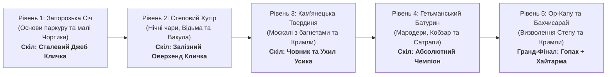

# Прогресія рівнів та казковий сюжет для гравців від 8 років («Geek Jack: Джура»)

**Вікова аудиторія:** 8–14 років та сімейний геймінг.  
**Стиль оповіді:** Героїчна козацька казка-пригода, сповнена народного гумору, лицарської звитяги, дружби народів та перемоги світла над темрявою.  
**Педагогічний та психологічний фокус:**
1. **Зрозумілість правил:** Кожен рівень вводить рівно один новий тип ворога і одного друга-помічника.
2. **Гумор замість жорстокості:** Вороги не гинуть криваво, а комічно лякаються, втрачають шапки, заплутуються у власних каптанах і тікають за екран від характерницького сміху й світла.
3. **Побратимство та взаємовиручка:** Козак Джура перемагає не наодинці, а завдяки дружбі з вірними друзями (Киримли, Вакула, Кобзар, Мавка).

---

## 🗺️ Карта Пригод Джури (5 Сюжетних Етапів)

---

## 📜 Детальний розбір рівнів

### 🏰 Рівень 1: «Запорозька Січ на Хортиці» (Початок шляху)
- **Сюжет для дитини:** Джура щойно прибув на Січ і склав козацьку присягу. Старий козак-характерник доручає йому перше лицарське завдання: зібрати на бойових помостах порохові ядра для фортечних гармат, поки бешкетні чортики не поцупили ґноти!
- **Новий ворог:** **Гоголівський Чортик-крутько**. Бігає, високо підстрибує, намагається підібратися до ядра.
- **Друг-наставник:** **Козак Мамай** біля куреня. Дає підказки великими літерами на екрані: *«Стрибай вище, Джуро!»*, *«Розправляй поли киреї!»*.
- **Чому зрозуміло 8-річним:**
  - Прості рівні дубові платформи.
  - Навчання ширянню на крилах киреї.
  - Перша радість від збору *Цвіту Папороті* (чортики витріщають очі й тікають).

---

### 🌾 Рівень 2: «Степовий Хутір та Чумацький Шлях» (Нічна казка)
- **Сюжет для дитини:** Нечиста сила напустила густий морок і задула зорі на небі, щоб збити з путі чумацький обоз із сіллю. Джура вирушає в степ, щоб зібрати вогняні ядра й знову запалити Чумацький Шлях золотими іскрами!
- **Новий ворог:** **Нічна Відьма на мітлі (Солоха)**. Літає вгорі та сипле зоряним сріблястим попелом.
- **Друзі-помічники:**
  - **Коваль Вакула:** Викував Джурі підківки (стрибок стає ще пружнішим).
  - **Домовик мазанки:** Виставляє на вікно глечик узвару, що знімає сповільнення від відьомського попелу.
- **Нова механіка для дитини:** Маневрування в повітрі між відьмою, що літає, та платформами з солом'яними стріхами.

---

### 🛡️ Рівень 3: «Кам'янецька Твердиня» (Степове Побратимство)
- **Сюжет для дитини:** До стародавньої подільської фортеці підійшли чужинці-загарбники — царські солдати Меншикова. Вони хочуть розграбувати козацький арсенал. Але на поміч Січі прибуває вірний степовий побратим — молодий вершник-Киримли!
- **Нові вороги:** **Москалі-стрільці з багнетами**. Важко крокують кам'яними карнизами вперед і назад, пихато надимаючи щоки. Стрибати на них прямо не можна — вколешся об багнет!
- **Новий союзник:** **Кримли-Побратим (Qırımlı Yigit)**.
  - Стоїть на високій вежі з композитним луком.
  - Періодично пускає влучну стрілу з білим пером, яка збиває дальніх відьом і скидає шапку з ворожого солдата.
  - Дарує Джурі *Золоту Тарак-Тамгу* (щит від одного уколу).
- **Нова механіка для дитини:**
  - Вчимося не просто стрибати, а пролітати над багнетами на киреї або заходити ворогові за спину.
  - Вперше спрацьовує правило «Твердої стелі» кам'яних склепінь.

---

### 🏛️ Рівень 4: «Гетьманський Батурин» (Захист Скарбниці)
- **Сюжет для дитини:** Сатрапи намагаються викрасти гетьманські клейноди та золото війська Запорозького, підкинувши замість них підступного біса Басаврюка з фальшивими черепками. Джура має захистити батуринські палаци та скликати велику Раду!
- **Новий ворог:** **Блукаючі вогники-потерчата** (з рівня 4). М'яко пливуть повітрям і відбиваються від стін, немов мильні бульбашки.
- **Інші випробування:**
  - **Москаль-мародер з мішком:** Намагається вкрасти ядра прямо з платформи.
  - **Басаврюк (заплановано, ще не реалізовано):** Розкидає фальшиві монети-сажуки.
- **Друзі-помічники:**
  - **Сліпий Кобзар із поводирем:** Заграє на бандурі пісню правди — всі мародери кидають мішки, а чорти застигають у ступорі!
  - **Бахчисарайське кахве:** Дає Джурі супер-швидкість на 10 секунд.
- **Нова механіка для дитини:** Пріоритет цілей (швидко підібрати підсвічені ядра, не чіпаючи фальшивих монет Басаврюка).

---

### 🌙 Рівень 5 (Гранд-Фінал): «Ор-Капу, Перекоп і Бахчисарай» (Свято Вільних Народів)
- **Сюжет для дитини:** Джура та його побратим Киримли прямують до Перекопського валу (Ор-Капу) та Бахчисарая, щоб звільнити стародавні торговельні й чумацькі шляхи від загарбників і назавжди очистити рідну землю від темряви.
- **Випробування:**
  - Окупаційні стрільці-москалі та відьми намагаються заблокувати браму фортеці.
  - Спільна координація: Джура маневрує на платформах, а вірний Киримли-Побратим веде прицільний вогонь із композитного лука зі сторожової вежі.
- **Друзі-помічники:**
  - **Чарівні Підківки Вакули:** Допомагають легко злітати на найвищі зубці мурів.
  - **Киримли-Побратим (Qırımlı Yigit):** Вражає ворогів стрілами з білим соколиним пір'ям.
- **Фінал казки:**
  - Зібравши всі 24 вогняні ядра, Джура та Киримли розсіюють ворожу облогу.
  - Загарбники у паніці гублять ківери й тікають до боліт.
  - **Грандіозний фінальний танець дружби:** Джура танцює чемпіонський 6-фазний бойовий Гопак з чотирма поясами Абсолютного Чемпіона, а поруч Киримли кружляє у вогняній Хайтармі під оплески вільних народів!

---

## 🥊 Бойові Навички Чемпіонів та Еволюція Переможного Гопака
Детальну специфікацію механік ударів та їх розблокування дивіться в меморандумі:  
👉 **[MEMO_BOXING_SUPERHEROES_PROGRESSION.md](file:///home/mfedchyk/geek-jack/docs/MEMO_BOXING_SUPERHEROES_PROGRESSION.md)**.

- **Рівень 1 $\to$ Володимир Кличко:** Опанування «Сталевого Джебу» (`X`/`J`/`Ctrl`), збагачення Фази 1 Гопака прямим золотим ударом.
- **Рівень 2 $\to$ Віталій Кличко:** Опанування «Залізного Оверхенда/Хука», збагачення Фази 2 Гопака нищівною присядкою.
- **Рівень 3 $\to$ Олександр Усик:** Опанування «Човника та Ухилу», збагачення Фази 4 Гопака височенною шпагатною «розніжкою» ($38\text{ px}$).
- **Рівень 4 $\to$ Синергія Трьох:** Повна чемпіонська комбінація, 4 обертові пояси Абсолютного Чемпіона (WBC, WBA, IBF, WBO) у Фазі 6.
- **Рівень 5 $\to$ Спільне Тріумфальне Свято:** Парний тріумф — Гопак Джури та Хайтарма Киримли.

---

## 🧒 Чому це ідеально сприймається дітьми від 8 років?
1. **Зрозуміле добро і зло:** Козак та кримський побратим захищають свій дім, а нечисть і загарбники чинять капості.
2. **Комічний ефект перемоги:** Діти люблять, коли грізний на вигляд ворог потрапляє в кумедну халепу (втрачає штани, плутається в шинелі, тікає від гарбуза).
3. **Гордість за рідну культуру:** Дитина бачить красивий, сильний, стильний образ українського лицаря-підлітка (Джури), чує рідну мову, бандуру, бачить козацьке бароко та велич фортець.

---

## 🧭 Прогресія NPC та коефіцієнт складності (рішення власника, 2026-10-24)

### Новий NPC на кожному рівні
Кожен рівень серії вводить щонайменше одного нового NPC (ворога або союзника), але не більше одного нового типу ворога:

| Рівень | Новий ворог | Новий союзник |
|---|---|---|
| 1 | Чортик-робот | Гуцул-опришок |
| 2 | Відьма-інженер | — |
| 3 | Москаль | Киримли-побратим |
| 4 | Блукаючий вогник | — |
| 5 | — | **Мавка** (лісова чарівниця: чарами лякає найближчого ворога кожні ≈9 с) |

Таблиця закодована в `scripts/difficulty.gd` (`NPC_INTRO`) і перевіряється тестом. Нові NPC для наступних серій (Домовик, Кобзар, Вій, Басаврюк, Злидні) заплановано в мемо.

### Серії рівнів і коефіцієнт складності K
Рівні 6–10 повторюють серію 1–5, але складніше (склад ворогів, платформи й тло циклічні). Складність рівня задає коефіцієнт:

`K = clamp( (1 + 0,30 · номер_серії) · (0,85 + 0,30 · Q_попереднього_рівня), 0,8 … 2,5 )`

Рівень 1 і нейтральна якість Q = 0,5 дають K = 1,0.

**Якість проходження Q (0…1)** = 0,4 · швидкість + 0,4 · відсутність ударів + 0,2 · серія запалених ядер:
- швидкість: 1 за час ≤ 0,6 від еталонного (90 с), 0 за час ≥ 1,5 від еталонного;
- відсутність ударів: кожен удар ворога знімає 34%;
- серія ядер: найдовша серія запалених ядер, нормована до 8.

**Що змінює K:**
- кількість ворогів: додаються вороги вже введених типів (не відьми), +`round(склад · (K − 1))`, не більше 4; базовий склад із новим NPC не зменшується;
- частота й темп: швидкість ворогів ×(1 + 0,5 · (K − 1)), у межах 0,85…1,6;
- союзники: поріг прибуття допомоги ділиться на K (чим складніше, тим раніше); третій гуцул прибуває лише за K ≥ 1,5.

**Бонуси за проходження:** `Q · 5000` + 50 очок за кожну секунду під еталонний час + 1000 за бездоганне (без ударів) проходження. Бонус показується після Гопака.

Розрахунок `еталонного часу` (90 с) і темпу зростання (+30% за серію) є початковими оцінками й калібруються плейтестами (T-016).
