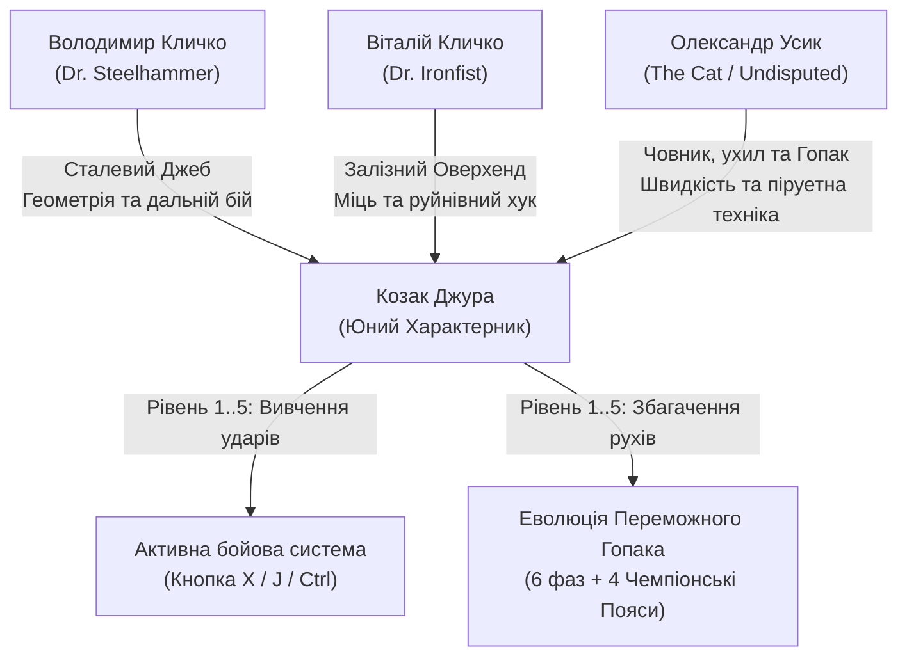
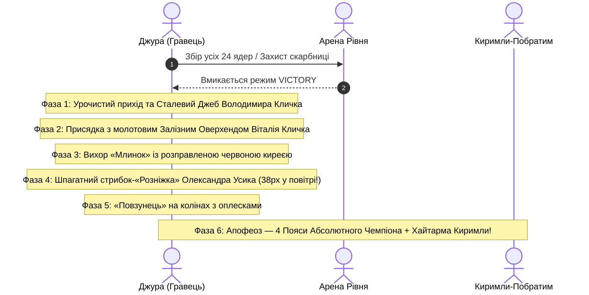

# Меморандум: Українські Супергерої Боксу як Прототипи Джури, Еволюція Бойового Гопака та Прогресія Скілів

**Проєкт:** «Geek Jack: Джура» (`~/geek-jack`)  
**Дата схвалення концепції:** 24 жовтня 2026 року  
**Авторська концепція:** Поєднання золотого фонду української анімації студії «Київнаукфільм» (*«Як козаки...»* Володимира Дахна) із пластикою, технікою та харизмою всесвітньо визнаних українських чемпіонів боксу — братів Віталія і Володимира Кличків та Олександра Усика.  
**Віковий рейтинг:** 8+ (Zero-Horror Invariant, мультяшний слепстік, героїчний патріотичний епос).

---

## 1. Концепція та Анімаційні Прототипи (Kyivnaukfilm meets World Champions)

Козак Джура — юний характерник і учень Січової школи, який вбирає в себе найкращі лицарські риси українського народу. Його спортивними, анімаційними та бойовими прототипами визначено трьох видатних українських боксерів-суперважковаговиків:

### 1.1. Володимир Кличко («Dr. Steelhammer»)
- **Анімаційна пластика:** Висока, струнка, шляхетна постава козака-богатиря. Ідеальна класична геометрія корпусу, довгі руки, зосереджений погляд.
- **Бойова техніка:** **«Сталевий Джеб» (Steelhammer Jab)**. Прямий, як стріла, далекосяжний удар лівою (або провідною) рукою, що зупиняє будь-яку атаку супротивника на дальній дистанції та відкидає ворога хвилею стисненого повітря.

### 1.2. Віталій Кличко («Dr. Ironfist»)
- **Анімаційна пластика:** Козацька кремезність, незламна залізна стійкість, психологічний тиск на ворога, безстрашний рух уперед.
- **Бойова техніка:** **«Залізний Оверхенд / Хук-Молот» (Ironfist Overhand & Hook)**. Руйнівний круговий або низхідний удар по дузі зверху вниз, від якого здригається поміст і розлітаються іскри. Застосовується як на землі, так і під час падіння в повітрі.

### 1.3. Олександр Усик («The Cat» / Абсолютний Чемпіон у двох категоріях)
- **Анімаційна пластика:** Козацький чуб-оселедець, пружинний танцювальний крок на носках («човник»), невловимі ухили корпусом, фірмовий козацький шпагат і бойовий гопак прямо на рингу після історичних тріумфів.
- **Бойова техніка:** **«Човник та Ухил-Контратака» (Usyk Slip-and-Counter Flurry)**. Стрімкий крок під кутом повз небезпеку (ухил від багнета чи вогника) з моментальним нанесенням вибухової трійки комбінаційних ударів.

---

## 2. Механіка Активного Бою (Active Player Attacks)

Починаючи з проходження першого рівня, Джура не лише уникає ворогів і збирає ядра, а й володіє активними козацько-чемпіонськими ударами:

### 2.1. Керування
- **Клавіатура:** Клавіші `X`, `J` або `Left Ctrl`.
- **Геймпад:** Кнопка дії 3 (Button 3 — `X` на PlayStation / `Square`, або `X` на XInput / Logitech F310).

### 2.2. Хітбокси та Фізика Зіткнення
- Функція `_check_strike_hitbox()` у [`scripts/player.gd`](file:///home/mfedchyk/geek-jack/scripts/player.gd) формує активний радіус ураження ($30\dots 40\text{ px}$) у напрямку погляду Джури.
- Атака ефективно нейтралізує ворогів перед Джурою:
  - **Чортики:** Отримують гучний ляпас (`bonk`), витріщають очі, закручують хвостики й дають драпака колесом ніжок.
  - **Москалі-загарбники:** Удар збиває високий конічний капелюх/ківер, вибиває з рук бердиш/фузею та личаки, змушуючи ворога з криком панічно тікати за край екрана.
  - **Бали слави:** $+500$ очок за чорта, $+600$ очок за москаля без переривання множника комбо.

### 2.3. Візуальні Ефекти Слепстіку (Kyivnaukfilm Visuals)
- **Серпоподібні дуги удару:** Процедурні біло-золоті повітряні півмісяці, що малюються перед кулаком Джури.
- **Іскри звитяги:** $4\dots 6$ золотих іскорок і зірочок навколо точки влучання.
- **Нуль жорстокості:** Жодних травм чи крові — лише комічний переляк і політ капелюхів.

---

## 3. Покрокова Прогресія по Рівнях (Level-by-Level Skill Progression)

Опанування ударів супергероїв відбувається послідовно після завершення кожного рівня, підсилюючи як ігровий процес на наступних рівнях, так і фінальний Переможний Танець:

| Рівень | Назва та Локація | Здобутий Скіл Супергероя | Ігровий Ефект на наступних рівнях | Збагачення Переможного Гопака |
| :---: | :--- | :--- | :--- | :--- |
| **Рівень 1** | **Запорозька Січ на Хортиці** | **Володимир Кличко: «Сталевий Джеб»** (`STEELHAMMER_JAB`) | Далекосяжний прямий удар ($38\text{ px}$), миттєво збиває чортів на підльоті. | **Фаза 1 Гопака:** Шляхетний випад із викидом кулака Володимира та золотим спалахом. |
| **Рівень 2** | **Степовий Хутір та Чумацький Шлях** | **Віталій Кличко: «Залізний Оверхенд»** (`IRONFIST_HOOK`) | Важкий круговий хук, вражає ворогів зверху вниз під час стрибка або приземлення. | **Фаза 2 Гопака:** Потужний перехресний удар Віталія, що вибиває іскри з помосту. |
| **Рівень 3** | **Кам'янецька Твердиня** | **Олександр Усик: «Човник та Ухил-Контратака»** (`USYK_SLIP_COUNTER`) | Танцювальний підскок із перекатом повз багнет ворога та миттєвою комбінацією з 3 ударів. | **Фаза 4 Гопака:** Стрімкий шпагатний політ Усика (розніжка $38\text{ px}$) з танцем на носках. |
| **Рівень 4** | **Гетьманський Батурин** | **«Синергія Трьох: Абсолютний Чемпіон»** (`UNDISPUTED_TRIO`) | Надшвидкісна серія всіх чемпіонських ударів; навколо пояса сяють 4 золоті пояси (WBC, WBA, IBF, WBO). | **Фаза 6 Гопака:** Тріумфальний фінал із кружлянням поясів Абсолютного Чемпіона світу. |
| **Рівень 5** | **Ор-Капу, Перекоп і Бахчисарай** | **Гранд-Тріумф Вільних Народів** | Повний арсенал чемпіона застосовується для захисту кримських рубежів разом із лучником-Киримли. | **Парний Танець:** Чемпіонський Гопак Джури в ідеальному унісоні з танцем Хайтарма / Хоран Киримли-Побратима. |

---

## 4. Еволюція Переможного Гопака

Переможний танець Джури складається з 6 хореографічних фаз, кожна з яких після проходження відповідних рівнів отримує автентичні рухи чемпіонів:

### 4.1. Деталі Олімпійської Хореографії
1. **Фаза 1 (Початок):** Джура з гордою поставою підіймає кулак догори, імітуючи коронний вихід Володимира Кличка на чемпіонський бій.
2. **Фаза 2 (Присядка):** Глибока козацька присядка поєднується з перехресним розмахом важких хуків Віталія Кличка.
3. **Фаза 4 (Розніжка Усика):** Стрибок вгору на висоту до 38 пікселів, повне розведення ніг у повітряний шпагат із легким похитуванням головою та підмогуванням гравцеві.
4. **Фаза 6 (Абсолютний Чемпіон):** Навколо широкого золотого козацького пояса Джури починають кружляти чотири автентичні зелено-золоті чемпіонські пояси (WBC, WBA, IBF, WBO). Одночасно Киримли-Побратим виконує кримськотатарський танець кружляння (Qaytarma), створюючи свято братерства.

---

## 5. Архітектурна Реалізація в Кодовій Базі

1. **Модель гравця ([`scripts/player.gd`](file:///home/mfedchyk/geek-jack/scripts/player.gd)):**
   - Перелік навичок: `enum ChampionSkill { STEELHAMMER_JAB, IRONFIST_HOOK, USYK_SLIP_COUNTER, UNDISPUTED_TRIO }`.
   - Збереження розблокованих скілів: `var unlocked_skills: Array[ChampionSkill] = []`.
   - Вхідні команди: `_unhandled_input()` із підтримкою геймпадів та клавіатур.
   - Кінематика удару: `_perform_champion_punch()` запускає таймер анімації удару `punch_timer`.
   - Скелетні трансформації: `_compute_skeletal_pose()` модифікує позиції рук `hand_l`, `hand_r` і кути нахилу корпусу.
   - Візуалізація: у методі `_draw()` процедурно відмальовуються ударні серпи, іскри та обертання 4 чемпіонських поясів.
2. **Керування грою ([`scripts/game_manager.gd`](file:///home/mfedchyk/geek-jack/scripts/game_manager.gd)):**
   - Нагородження скілом: після завершення рівня викликається `player.unlock_champion_skill(skill)`.
   - Гарантована видача чарівних підківок Вакули на рівнях 2–5.
   - Спавн союзника Киримли ([`scripts/qirimli_ally.gd`](file:///home/mfedchyk/geek-jack/scripts/qirimli_ally.gd)) на рівнях 3, 4 та 5.
3. **Верифікація тестів ([`test/test_levels.gd`](file:///home/mfedchyk/geek-jack/test/test_levels.gd)):**
   - 100% покриття тестами всіх 5 рівнів, ворогів-москалів, союзника-Киримли та всіх 4 чемпіонських навичок боксу.

---

## 6. Педагогічне та Виховне Значення
- **Сучасні живі герої:** Діти бачать не абстрактні символи, а реальних українських легенд спорту, якими пишається весь світ.
- **Культура здорового духу:** Поєднання народного бойового мистецтва (Бойовий Гопак) із сучасною світовою школою боксу.
- **Шляхетність лицаря:** Справжній чемпіон захищає слабших, поважає побратимів і не проявляє невиправданої жорстокості.
