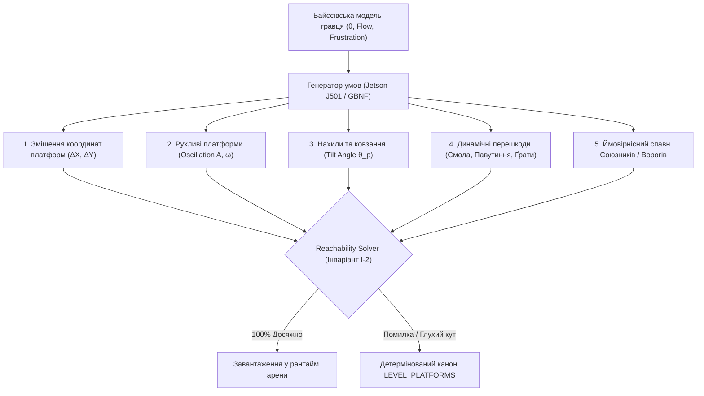

# 📜 MEMO: Генеративний синтез лабіринтів, варіативних платформ та динамічних перешкод

- **Статус:** Дослідження / Майбутній R&D етап (Future Scope Phase)
- **Контекст:** Гра «Козак Джура: початок шляху козака» (Godot 4, GDScript)
- **Апаратний профіль:** Вузол прискорення NVIDIA Jetson AGX Orin 64GB (J501, Ollama API, GBNF)
- **Трасування:** GDD §1.1, §6.5; SWR-002; ADR-002; Invariants I-1, I-2, I-3

---

## 1. Концепція та інженерні межі (Architecture Boundaries)

### 1.1. Інваріант детермінізму рантайму (Runtime Determinism Invariant)
В ігровому циклі 60 FPS (`_process`, `_physics_process`) категорично заборонено пряме звернення до локальних чи хмарних нейромереж. Причини:
1. **Нульова затримка (Zero-Latency):** Аркадний геймплей *Bomb Jack* та бойові дуелі *Karateka* вимагають миттєвого відгуку управління (input lag $\le 16$ мс).
2. **Безпека та стабільність для дітей 8–14 років:** Недетерміновані збої, галюцинації чи стрибки FPS неприпустимі.
3. **Приватність (Zero-Leak):** Ніякі дії чи біометрія гравця не передаються назовні.

### 1.2. Парадигма перед-рівневого синтезу (Ahead-of-Time Pre-Level Synthesis)
Генеративні моделі застосовуються **виключно у фоні під час демонстрації міжрівневих карток-слайдів (Story Cards / Mission Briefing)**:
- Поки дитина читає казковий діалог Наставника або розглядає ілюстрацію (вікно 6–15 секунд), локальний обчислювальний вузол Jetson AGX Orin J501 генерує параметри наступного рівня за $1.2 \dots 2.5$ с.
- Згенерований макет проходить суворий локальний математичний розв'язувач прохідності (**Reachability Solver**, інваріант $I-2$).
- Якщо макет верифіковано на 100% прохідність — він плавно застосовується при переході. Якщо є сумнів — рантайм миттєво відкочується до детермінованого канонічного макета з таблиці `LEVEL_PLATFORMS`.

---

## 2. Ступені свободи та варіативні просторові елементи

Майбутнє дослідження охоплює 5 керованих ступенів свободи:

### 2.1. Зміщення позицій платформ ($\Delta X, \Delta Y$)
- Базові опорні точки платформеного каркаса варіюються у допустимому конусі стрибка Джури:
  $$\Delta X \in [-48, +48] \text{ px}, \quad \Delta Y \in [-32, +24] \text{ px}$$
- Висота стелі над платформою ніколи не падає нижче зросту героя з урахуванням чуба ($H_{\min} \ge 68$ px).

### 2.2. Рухливість платформ (Mobile Platforms)
- Платформи отримують синусоїдальний гармонійний рух:
  $$x(t) = x_0 + A_x \cdot \sin(\omega_x t + \phi_x), \quad y(t) = y_0 + A_y \cdot \cos(\omega_y t + \phi_y)$$
- Амплітуда $A \le 64$ px, швидкість руху плавна ($v \le 40$ px/s), щоб дитина могла точно розрахувати таймінг приземлення.

### 2.3. Нахили та ковзкі поверхні (Tilting & Slopes)
- Нахил балок під кутом $\alpha \in [-18^\circ, +18^\circ]$ (дерев'яні трапи чайок, дахи мазанок, скельні уступи Чуфут-Кале).
- Приземлення на похилу балку активує вектор ковзання з коефіцієнтом тертя $\mu$, що спонукає гравця застосовувати паркурний перекат або вчасний поштовховий стрибок.

### 2.4. Динамічні перешкоди (Interactive Hazards)
- **Діжки зі смолою:** сповільнюють рух Джури при контакті, але можуть бути підпалені Вогником або розбиті Булавою Котигорошка.
- **Підйомні чавунні ґрати (Portcullis):** опускаються за таймером або відкриваються при натисканні плит тиску (*Prince of Persia mechanic*).
- **Липке павутиння:** затримує Джуру на 1.5 секунди; випалюється смолоскипом або розсікається козацьким прямим тичком.

### 2.5. Адаптивне зважування спавну ворогів і союзників
- Модель на основі навичок гравця $\theta$ (за калібруванням Раша) динамічно регулює склад хвиль:
  - Якщо гравець у стані нудьги (*Boredom*): швидший спавн Вогника-палія, скорочення паузи до викрадення ядер Чортиком;
  - Якщо гравець у фрустрації (*Frustration*): поява дружнього білого сапсана Караґьоза чи побратима Киримли, який збиває полум'я стрілою або скидає козацький оберіг.

---

## 3. Вимоги до апаратного вузла Jetson AGX Orin (J501) та граматик GBNF

1. **GBNF-граматика (Strict JSON AST):**
   Вихід моделі моделюється граматикою `level_spec.gbnf`, що унеможливлює видачу невалідного синтаксису чи координат поза межами екрана ($960 \times 540$).
2. **Модель генерації:**
   - Рекомендована: `qwen2.5:32b` або дистильована спеціалізована модель `djura-levelgen:7b`.
3. **Швидкодія:**
   Час генерації $\le 2.0$ с на 64GB UMA LPDDR5 пам'яті (енергопрофіль MAXN 60W).

---

## 4. Поточний статус розробки (Milestone Focus)

> [!IMPORTANT]
> **Пріоритет поточного етапу:**
> Генеративні варіації геометрії відкладено у фазу R&D.
> **Поточний фокус:**
> 1. Бездоганні сценарні преамбули (міжрівневі слайди місій та діалоги Наставника для дітей 8–14 років).
> 2. Відточений геймплей Етапу 1 (Рівні 1–5: Запорозька Січ) із детермінованою геометрією арени, плавною прогресією навичок Джури (тичок $\to$ Залізний Хрест $\to$ ухил $\to$ Трійка $\to$ Булава Котигорошка) та чесним наростанням складності ворогів (Вогник $\to$ Чортик $\to$ Відьма Солоха).
