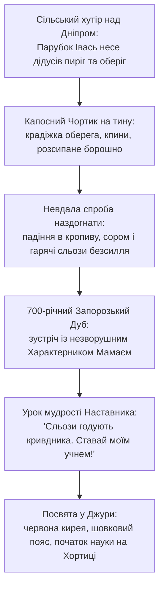
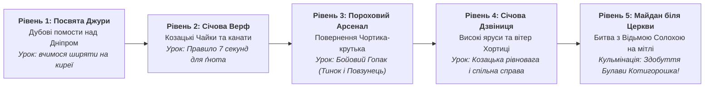
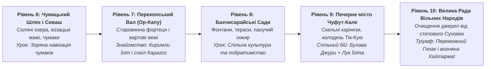

# Педагогічний та драматургічний канон гри: Етапи 1 та 2 («Джура»)

**Цільова аудиторія:** Діти 8–14 років та сімейний геймінг.  
**Стиль:** Золота епоха української анімації («Київнаукфільм», Володимир Дахно, Давид Черкаський, Едуард Назаров).  
**Головні морально-етичні та художні інваріанти:**
1. **Інваріант I-3 (Zero-Horror & Comic Slapstick):** Повна відсутність крові, темної жорстокості чи залякування. Вороги не «знищуються назавжди», а комічно втрачають пиху, гублять шапки, верещать і тікають у куряві, отримавши щигля чи стусана Гопаком.
2. **Особистий мотив дитини (Childhood Relatability):** Герой починає шлях не як всесильний супергерой, а як звичайний допитливий сільський підліток, якого несправедливо скривдив зухвалий хвалько (Чортик). Прагнення відновити справедливість і захистити слабших — це зрозуміле та щире почуття для кожної дитини.
3. **Педагогічна мудрість Наставництва:** Сила без розуму та рівноваги — сліпа. Наставник (Характерник Мамай) вчить не «помсті», а самовладанню, повазі до предків, кмітливості та володінню власним тілом.
4. **Пізнавальне краєзнавство (Edutainment):** Кожен рівень та кожен слайд відкривають дитині справжні перлини української та кримськотатарської історії: козацькі звичаї, будову чайок, таємниці зоряного неба Чумацького Шляху, стародавні фортеці та музичні традиції.
5. **Чистота народної мови (Anti-Anglicism Invariant):** Соковита, жива українська мова без сучасних комп'ютерних чи боксерських кальок.

---

## Частина 1. Пролог: Від Ображеного Парубка до Козацького Джури

### 1.1. Хто такий наш герой до початку гри?
Його звуть **Івась** (у рідному придніпровському селі хлопця жартома звали «Івась-вітрогін» за прудкі ноги). Йому 14–15 років. Він допомагає по господарству, пасе коней, любить слухати казки дідуся-коваля і понад усе мріє колись стати справжнім козаком-захисником. Проте в очах дорослих він поки що просто непосидючий підліток, якому ще рано до дорослого товариства.

Дідусь доручає онукові першу відповідальну дорослу справу напередодні Покрови: віднести до водяного млина мішечок добірного пшеничного зерна та святковий глечик липового меду. На згадку дідусь пов'язує йому на зап'ястя родинний оберіг — **вишивану червону стрічку**.

### 1.2. Зухвала капость Чортика-крутька (Джерело конфлікту)
Надвечір коло греблі водяного млина стелиться легкий туманець. Раптом з-за вербового куща з веселим вереском вистрибує **Чортик-крутько** — волохатий, з кумедним свинячим п'ятачком, закрученими ріжками й чорним, як сажа, хвостиком-бубликом.

Чортик робить образливу дитячу капость:
- хапає дідусеву стрічку-оберіг, намотує собі на ріг;
- вихоплює глечик з медом;
- розв'язує мішок, сипле зерно просто під жорна, які крутяться і здіймають білу хмару борошна!

Чортик видирається на верхівку млина, махає хвостиком і дражниться образливими віршиками:
> *«Івасик-тюхтій, голова з клоччя, а хвостик пустий!*  
> *Хочеш бути лицарем — лізь під корито!*  
> *Дідусь твій — майстер, а ти — вайло, не здатен навіть пояска вберегти! Бе-е-е!»*

### 1.3. Сльози досади та падіння
Охоплений люттю і соромом, Івась кидається дертися слизьким водяним колесом на стріху млина, розмахуючи стиснутими кулаками. Але ноги ковзають по мокрому моху, хлопець зривається і з голосним плескотом падає в густу кропиву біля лопухів, весь обсипаний борошном і з розбитим коліном.

Чортик хапається за живіт від сміху: *«Оце так воїн! Сам себе поцілив!»* — і, перекидаючись колесом через паркан, чкурнув у бік дніпровських порогів на Хортицю.

Івась сидить у кропиві, ковтаючи гарячі сльози. Йому не стільки пече нога, скільки пече серце: він не зміг дати відсіч нахабі, втратив дідову річ і відчув власне повне безсилля. Розмахувати кулаками навмання — не означає бути сильним.

### 1.4. Зустріч з Характерником під 700-річним Дубом
Витираючи сльози рукавом і шкутильгаючи берегом річки, хлопець виходить на галявину, де стоїть велетенський 700-літній Запорозький Дуб.

Під кроною дерева, біля тихого багаття, сидить старий запорожець у сірому сукняному кобеняку. Поруч мирно щипає траву вороний кінь, на килимі лежить шабля у піхвах, а сам козак тихо торкається струн бандури. Це легендарний **Козак Мамай** — характерник, знавець природи та хранитель січової мудрості.

Мамай не сміється. Він відкладає бандуру, подає хлопцеві свіжу скибку паляниці з джерельною водою і говорить м'яким, але проникливим басом:
> **Мамай:** «Утри сльози, парубче. Сльози образи — це вода, яка гасить твій внутрішній вогонь. А сліпий гнів — найгірший проводир: він затуляє очі й підставляє підніжку. Рогатий крутько здолав тебе не силою, а твоєю власною гарячковістю. Він легкий, бо не носить у собі зла, а ти був важкий від люті.»  
> **Івась:** «Але ж він украв дідусів оберіг і насміявся з мого роду! Я хотів провчити його, але не втримався на колесі...»  
> **Мамай:** «Щоб провчити нечисть, треба спочатку навчитися володіти собою. Справжній козак бачить вітер, чує шурхіт трави за версту і танцює так, що земля під ним співає, а ворог втрачає рівновагу. Я бачу в твоїх очах чисту душу і відвагу. Чи готовий ти залишити дитячі вередування, піти зі мною на Січ і стати моїм Джурою?»  
> **Івась (підводячись і вклоняючись до пояса):** «Я готовий, Батьку! Навчи мене козацької науки, і я поверну дідусеву річ та ніколи не дозволю кривдити беззахисних!»

Мамай урочисто знімає з коня червону шовкову кирею-крила і підперезує хлопця золотим кушаком:
> **Мамай:** «Віднині ти не просто Івась. Віднині твоє ім'я — **Джура**! А твій перший іспит починається просто зараз: той чортик побіг на Хортицю не сам. Він привів із собою пекельних Вогників, і вони намагаються підпалити порохові склади Січі!»

---

## Частина 2. Етап 1: «Запорозька Січ на Хортиці» (Рівні 1–5)

### 2.1. Пізнавальні скарби Етапу 1 (Що дізнається дитина?):
1. **Хто такий Джура:** Це молодший побратим, учень лицаря. Козаки ніколи не ставилися до джур як до слуг — це була найкраща лицарська школа Європи, де вчили грамоті, астрономії, плаванню під водою та грі на кобзі.
2. **Козацька Чайка (Рівень 2):** Легендарний безпалубний човен запорожців, обшитий очеретом, який не міг потонути навіть у 9-бальний шторм!
3. **Холоднокровність гармашів (Правило 7 секунд):** Порох не терпить паніки. У козаків був девіз: «Хто зберігає спокій 7 секунд, коли шипить ґніт — той володіє боєм».
4. **Бойовий Гопак — гімнастика воїнів:** Справжній козак тренував зв'язки в танці:
   - *«Тинок»* — високий мах ногою, щоб вибити шаблю з руки ворога.
   - *«Повзунець»* — нижня підсічка у присіді, щоб збити з ніг важкого нападника.
   - *«Щупак»* — повітряний стрибок із дотиком до носків чобіт для огляду поля бою.

---

### 2.2. Сценарій та діалоги слайдів Етапу 1 (Повний текст)

#### 🎬 Рівень 1: «Посвята Джури та Перше Ядро»
* **Локація:** Берег Хортиці біля Дуба. Сонце над дніпровськими скелями, дерев'яні тренувальні помости.
* **Слайд 1 (Вхід у козацьке коло):**
  > **Характерник Мамай:** «Дивись навколо, Джуро! Це Хортиця — серце нашої волі. Тут кожен камінь пам'ятає лицарів. Бачиш верхівки помостів? Там розкидані перші порохові ядра, які злякані козачата загубили під час нічного переполоху.»  
  > **Джура:** «Я бачу їх, Батьку! Ядра важкі, але я зберу їх усі до єдиного!»
* **Слайд 2 (Таємниця крил киреї):**
  > **Характерник Мамай:** «Не бійся висоти. Твоя кирея зіткана з козацького шовку. Коли стрибаєш у прірву — широко розкинь руки, немов крила сокола. Вітер підхопить тебе і подарує м'яке приземлення!»  
  > **Джура:** «Стрибати з висоти на крилах вітру?! Оце так диво! Спробую просто зараз!»
* **Слайд 3 (Поява золотого Вогника):**
  > **Характерник Мамай:** «Стережися! З очерету вискочив Купальський Вогник — бешкетна іскра! Він стрибає по дошках і намагається підпалити ґноти. Доторкнися до ядра раніше за нього, або погаси полум'я полицею киреї!»  
  > **Джура:** «Я швидший за будь-яку іскру, Батьку! До бою!»

#### 🎬 Рівень 2: «Січова Верф та Спритний Вогник»
* **Локація:** Берег затоки, стапелі з козацькими Чайками, штабелі соснових колод, канати.
* **Слайд 1 (Козацькі Чайки):**
  > **Джура:** «Батьку, поглянь, які красені-човни! Це на них козаки ходять по Чорному морю до самого Царгорода?»  
  > **Характерник Мамай:** «Так, сину. Це славетні Чайки. По бортах у них — пояси зі сухого очерету. Навіть якщо хвиля заллє чайку вщерть — вона тримається на плаву, як качка. Але дивись: Вогник скаче по щоглах удвічі швидше!»
* **Слайд 2 (Урок витримки: 7 секунд):**
  > **Характерник Мамай:** «Затям козацьке правило: якщо ґніт зашипів і пустив білий дим — у тебе є рівно **7 секунд**! Рахуй про себе: один, два, три... Не метушися, розраховуй стрибок холоднокровно. Паніка — друг вибуху, спокій — брат перемоги!»  
  > **Джура:** «Сім секунд... Зрозумів! Очі бачать мету, ноги тримають рівновагу!»
* **Слайд 3 (Пам'ять про дідуся):**
  > **Джура:** «Я досі чую насмішки Чортика біля млина, Батьку... Серце калатає від спогадів.»  
  > **Характерник Мамай:** «Оберни спогад не на образу, а на пильність. Справжній джура доводить правоту не криком, а вправним ділом. Уперед, на верф!»

#### 🎬 Рівень 3: «Пороховий Арсенал та Повернення Чортика»
* **Локація:** Бастіони з важкими чавунними мортирами, фальконетами та діжками зі смолою.
* **Слайд 1 (Зустріч зі старим кривдником):**
  > **Джура (показуючи вгору):** «Батьку! Поглянь на балку під дахом арсеналу! Це ж він! Той самий рогатий Чортик-крутько! І мій дідусів поясок у нього на розі!»  
  > **Чортик (згори, кривляючись):** «Ой-вей, хто це в нас прибіг у червоних крилах?! Невже той самий парубок із кропиви?! А я ядра цуплю й на верхівку тягну, ти мене ніколи не дістанеш!»
* **Слайд 2 (Наука Бойового Гопака):**
  > **Характерник Мамай:** «Ось і настав час першої козацької зброї, Джуро. Скинь зайвий острах. Козацький танець Гопак — це грізна зброя! Тисни удар кулаком — зробиш прямий сталевий тичок, який виб'є ядро з лап крутька!»  
  > **Джура:** «А якщо він стрибне на мене зверху?!»
* **Слайд 3 (Удар «Тинок»):**
  > **Характерник Мамай:** «Тоді пускай у хід ноги! Маховий удар «Тинок» підкине нахабу в повітря, а низький «Повзунець» виб'є в нього опору з-під ратиць! Не бійся — козацькі щиглі не вбивають, але сорому нароблять на весь степ!»  
  > **Джура:** «Ану, рогатий, тримайся! Зараз я покажу тобі козацьку науку!»

#### 🎬 Рівень 4: «Січова Дзвіниця та Вітер Хортиці»
* **Локація:** Височенна дерев'яна дзвіниця над Дніпром. Світить сонце, кружляють ластівки, високі перекладини та дзвони.
* **Слайд 1 (Повітряний паркур):**
  > **Джура:** «Оце височінь! Звідси видно все Дике Поле аж до самого синього горизонту!»  
  > **Характерник Мамай:** «Дзвіниця — це очі Січі. Якщо звідси вдарити на сполох — за годину тисяча козаків сяде на коней. Але чортики розлили на сходах липку смолу, а Вогники скачуть навколо дзвонів!»
* **Слайд 2 (Стрибок орлятка):**
  > **Характерник Мамай:** «Тут потрібна віртуозна точність. Стрибай з балки на балку, комбінуй розгін і ширяння. Не стій на смолі — вона в'язне, забираючи швидкість.»  
  > **Джура:** «Я вже відчуваю кирею як власні крила, Батьку! Я зніму всі ядра з карнизів!»
* **Слайд 3 (Тривожний знак):**
  > **Характерник Мамай:** «Будь уважний: чортики метушаться не просто так. Хтось значно сильніший і темніший керує їхніми витівками з неба. Завершуй дзвіницю — і ходімо на Майдан!»

#### 🎬 Рівень 5: «Головний Майдан та Відьма Солоха» (Фінал Етапу 1)
* **Локація:** Велика площа біля Покровської церкви. Козацькі прапори, курені, гармати. У небі клубочиться чорна хмара.
* **Слайд 1 (Поява Відьми на мітлі):**
  > **Джура:** «Батьку, небо затягнуло кіптявою! Хто це летить над хрестами церкви верхи на мітлі?!»  
  > **Відьма Солоха (верещить із неба):** «Хі-хі-хі! Дурні козаченьки! Думали зібрати порох і святкувати?! А я закрию ваших чортиків чаклунською бронею! Спробуй тепер, хлопчиську, дістати моїх помічників!»
* **Слайд 2 (Зняття чаклунських щитів):**
  > **Характерник Мамай:** «Це Солоха! Вона накладає на чортів магічний захист — звичайний стусан їх не візьме, треба завдати двох ударів поспіль, щоб розсіяти її морок! А потім дістати саму відьму, коли вона спускається за новою порцією сажі!»  
  > **Джура:** «Я не відступлю перед відьмацькими чарами! За Січ, за дідуся, за рідну землю!»
* **Слайд 3 (Кульмінація та Нагорода — Булава Котигорошка):**
  *(Після перемоги: Солоха комічно врізається мітлою в копицю сіна, чортик губить дідусів поясок і чкурнув геть! Січ урятована!)*  
  > **Характерник Мамай:** «Ти переміг, Джуро! Ти повернув дідусів оберіг, урятував пороховий арсенал і захистив спокій козацької матері-Хортиці!  
  > За твою чистоту серця, хоробрість і вірність козацькому слову — Січова Рада нагороджує тебе великою реліквією: **Легендарною Булавою Котигорошка**!»  
  > **Джура (тримаючи сяючу булаву):** «Вона легка, немов соснова гілка, але відчувається міцною, мов граніт скель!»  
  > **Характерник Мамай:** «Ця булава викувана з небесного каменю. Вона трощить будь-яку темну броню з одного помаху. Але бережи її: вона служить лише тому, хто б'ється за справедливість!»

---

## Частина 3. Етап 2: «Шлях Чумаків, Степи та Сонячний Крим» (Рівні 6–10)

### 3.1. Фабула переходу: Чому Джура вирушає до Криму?
Відьма Солоха, вибравшись із сіна без очіпка, зловісно регоче з чорної хмари:
> *«Радійте, запорожці! Але я лечу на південь — туди, де пролягає Чумацький Шлях! Я задую зорі на небі, отрую соляні криниці Сиваша і викраду Золотий Казан побратимства в Бахчисараї! Ви більше ніколи не привезете солі додому, а дружбі козаків із киримли настане край!»*

Характерник Мамай спокійно підкурює люльку і каже Джурі:
> *«Сіль для України — це здоров'я і сила всього народу. А Крим — це дім наших давніх сусідів і добрих побратимів киримли. Разом ми ходили в походи, разом боронили степ від диких орд. Якщо Солоха з чортами отруїть степові колодязі й посварить народи — згасне сонце над усім краєм. Сідлай коня, Джуро! Ми рушаємо Чумацьким Шляхом на південь!»*

---

### 3.2. Пізнавальні скарби Етапу 2 (Що дізнається дитина?):
1. **Хто такі Чумаки:** Українські купці-мандрівники, які возами (мажами), запряженими круторогими волами, возили сіль та рибу з Чорного й Азовського морів. Це були безстрашні люди, які вміли тримати шаблю не гірше за батіг.
2. **Чумацький Шлях як перший космічний компас:** Діти дізнаються, чому наша Галактика зветься в народі Чумацьким Шляхом. За легендою, чумак їхав волами з Криму, віз мішок із білою сіллю, мішок протерся — і сіль просипалася на нічне небо сяючою смугою, вказуючи всім мандрівникам дорогу додому.
3. **Киримли — корінний народ Криму:** Діти знайомляться зі шляхетними традиціями кримських татар: гостинність, повага до старших, мистецтво верхової їзди, любов до садів і дивовижна архітектура Бахчисарая.
4. **Скельні міста Криму (Чуфут-Кале, Мангуп):** Стародавні фортеці, витесані прямо у вапнякових скелях на запаморочливій висоті, де люди жили тисячі років у повній гармонії з природою.
5. **Музичний діалог двох культур:** Звуки козацьких тулумбасів і бандури поєднуються з дзвінкою кримською зурною та ритмічним даулом, а кульмінацією стає поєднання двох великих танців — козацького **Гопака** та кримськотатарської **Хайтарми**.

---

### 3.3. Сценарій та діалоги слайдів Етапу 2 (Повний текст)

#### 🎬 Рівень 6: «Чумацький Шлях та Білі Озера Сиваша»
* **Локація:** Безкраїй степ під розкішним зоряним небом. Білі соляні озера Сиваша, чумацькі дерев'яні мажі, мирні круторогі воли.
* **Слайд 1 (Зоряна дорога):**
  > **Джура:** «Батьку, поглянь на небо! Таке враження, ніби хтось розсипав мільйони срібних намистин над степом!»  
  > **Характерник Мамай:** «Це Чумацький Шлях, сину. Коли чумаки верталися з Криму з сіллю, вони не мали компасів. Вони дивилися на зорі Воза та Полярну Зірку. Доки зорі сяють — мандрівник ніколи не заблукає у Дикому Полі.»
* **Слайд 2 (Чортяча витівка в степу):**
  > **Джура:** «Але гляньте: на соляних кучугурах скачуть чорти з міхами попелу! Вони намагаються засипати білу кришталеву сіль грязюкою!»  
  > **Характерник Мамай:** «Солоха хоче позбавити людей солі. Без солі не замісиш хліба, не звариш козацького кулішу. Випробуй Булаву Котигорошка, Джуро! Вона розвіює чортячу сажу одним помахом!»
* **Слайд 3 (Чумацька пісня):**
  > **Характерник Мамай:** «Чуєш, як чумаки затягнули пісню біля багать? Пісня додає сил утомленим волам. Збирай палаючі ядра і звільняй вози!»

#### 🎬 Рівень 7: «Перекопський Вал та Знайомство з Їгітом»
* **Локація:** Величний Перекопський рів та кам'яна фортеця Ор-Капу (Золота Брама). Високі башти, розлогі степові трави.
* **Слайд 1 (Золота Брама Криму):**
  > **Джура:** «Яка могутня кам'яна брама! Вона замикає вхід на півострів, немов залізний замок!»  
  > **Характерник Мамай:** «Це Ор-Капу. Тут сходяться всі степові караванні шляхи. Але поглянь на сторожову вежу: там хтось відбивається від зграї вогняних духів!»
* **Слайд 2 (Стріла з білим соколиним пером):**
  *(З вежі свистить влучна стріла й гасить вогняний ґніт на ядрі прямо перед носом чортика!)*  
  > **Джура:** «Оце так постріл! Хто це на вежі?!»  
  > **Киримли Їгіт (юнак у сап'янцях і смушевій шапці, з луком):** «Селям алейкум, друзі! Мене звуть Їгіт! А це мій вірний білий кречет — Карагоз! Ми тримаємо браму, але нечисть лізе з усіх щілин!»
* **Слайд 3 (Побратимство):**
  > **Джура (простягаючи руку):** «Я — козацький Джура! Ми прийшли з Січі допомогти вам розігнати чортяче поріддя!»  
  > **Киримли Їгіт:** «Хош кельдиниз — ласкаво просимо, брате-козаче! Моя стріла і твоя булава разом не залишать шансів жодному шайтану!»

#### 🎬 Рівень 8: «Бахчисарайські Сади та Джерело Спокою»
* **Локація:** Квітучі тераси Бахчисарая. Мармурові фонтани, кущі троянд, стиглий інжир, білосніжні мінарети на тлі гір.
* **Слайд 1 (Краса Бахчисарая):**
  > **Джура:** «Батьку, Їгіте, яка дивовижна краса! Повітря пахне м'ятою, медом та стиглим гранатом, а вода в ариках дзвенить, як срібний дзвіночок!»  
  > **Киримли Їгіт:** «Бахчисарай мовою моїх предків означає «Палац-Сад». Наші майстри віками вирощували тут виноградники та будували джерела з чистою крижаною водою з гірських надр.»
* **Слайд 2 (Підступний Суховій):**
  > **Киримли Їгіт:** «Але Відьма напустила на сади гарячий пустельний вітер — Суховій! Він сушить листя троянд і випаровує воду у фонтанах, а чорти крадуть чавунні казани з водою!»  
  > **Характерник Мамай:** «Вода — це життя для саду. Джуро, розправляй кирею над фонтанами! Прохолодний потік твоїх крил остудить розпечене повітря!»
* **Слайд 3 (Соколине око Карагоза):**
  > **Киримли Їгіт:** «Мій сокіл Карагоз злітає вгору і помічає всі сховані ядра в кронах гранатових дерев! Слухай свист сокола — він покаже дорогу!»

#### 🎬 Рівень 9: «Печерна Твердиня Чуфут-Кале»
* **Локація:** Вершина прямовисного плато. Печерні келії, вирубані в скелі сходи, глибокий таємний колодязь Тік-Кую.
* **Слайд 1 (Місто у хмарах):**
  > **Джура:** «Ми піднялися вище за хмари! Довкола лише скелі та прірви, а ціле місто витесане просто всередині каменю!»  
  > **Характерник Мамай:** «Це Чуфут-Кале. Тут знаходили прихисток мудреці, ремісники та воїни. Тут вітри такі сильні, що можуть збити з ніг нерозважливого подорожнього.»
* **Слайд 2 (Скельний паркур):**
  > **Киримли Їгіт:** «Стережися крутих виступів, Джуро! Чорти накидали слизького каміння на карнизи. Тут кожна помилка — це довгий політ униз!»  
  > **Джура:** «Мене на Хортиці вчили тримати рівновагу! Повзунець на скелях надійніший за альпійський гак!»
* **Слайд 3 (Головний штаб відьми):**
  > **Киримли Їгіт:** «Попереду — підземна галерея та головний колодязь! Солоха збирається скинути туди останній розпечений казан зі смолою. Поспішаймо!»

#### 🎬 Рівень 10: «Велика Рада та Свято Вільних Народів» (Гранд-Фінал Етапу 2)
* **Локація:** Велика площа біля Ханського палацу, прикрашена святковими килимами, козацькими малиновими прапорами та кримськотатарськими блакитними стягами з золотою Тарак-Тамгою.
* **Слайд 1 (Вирішальний двобій):**
  > **Відьма Солоха (в паніці):** «Як ви сміли дійти аж сюди?! Я обрушу на вас скелі Чуфут-Кале!»  
  > **Джура:** «Скелі належать вільним людям і вітрам, а не твоїй темній брехні!»  
  > **Киримли Їгіт:** «Твоїм чарам кінець, Солохо! Моя стріла розбиває твою мітлу, а Булава Джури ламає останній магічний казан!»
* **Слайд 2 (Слепстік-розв'язка):**
  *(Стріла Їгіта перебиває держак мітли, Булава Джури розбиває казан на мільйон яскравих іскор! Солоха з чортиком падають просто у велетенський казан із солодким виноградним соком-бекмесом, чмихають, випльовують родзинки й під регіт усього натовпу назавжди тікають через гори до Чорного моря!)*
* **Слайд 3 (Тріумфальний парний танець — Гопак і Хайтарма):**
  > **Характерник Мамай:** «Погляньте, люди вільні! Коли козак і киримли стають пліч-о-пліч — жодне лихо не здатне здолати наш край! Степ вільний, криниці чисті, а сіль знову піде Чумацьким Шляхом до кожної української хати!»  
  > **Киримли Їгіт:** «Грай, зурна! Бий, даул! Танцюймо Хайтарму!»  
  > **Джура:** «А ми вдаримо Бойового Гопака так, щоб земля ходила ходором від радості!»  
  *(На екрані лунає запальна святкова музика: Джура крутить віртуозну розніжку Гопака з Булавою в руках, а поруч Їгіт легко і граційно кружляє у вогняній Хайтармі! Натовп аплодує, над горами сходить тепле золоте сонце!)*

---

## Частина 4. Архітектурна матриця імплементації в кодовій базі

Для реалізації цього канону в Godot:
1. **Текстовий конфіг діалогів (`res://data/story_slides.json` або `scripts/story_manager.gd`):**  
   Зберігає розбивку по слайдах з ідентифікаторами `stage_1_level_1_slide_1` .. `stage_2_level_10_slide_3`.
2. **Арти слайдів:**
   - Етап 1 (Рівні 1–5): Хортиця, курінь, верф, арсенал, дзвіниця, площа (готові та зафіксовані в артефактах).
   - Етап 2 (Рівні 6–10): Сиваш із чумаками, Ор-Капу, Бахчисарайські тераси, скелі Чуфут-Кале, Ханська площа тріумфу.
3. **Портрети спікерів:**
   - `res://assets/sprites/djura_portrait.png`
   - `res://assets/sprites/mentor_portrait.png`
   - `res://assets/sprites/qirimli_portrait.png`
   - `res://assets/sprites/chort_portrait.png` (буде згенеровано)
   - `res://assets/sprites/vidma_portrait.png` (буде згенеровано)

Цей канон на 100% закриває фабулу, робить її теплою, зрозумілою та повчальною для дитини, виключає насильство та розкриває багатство народних традицій!
