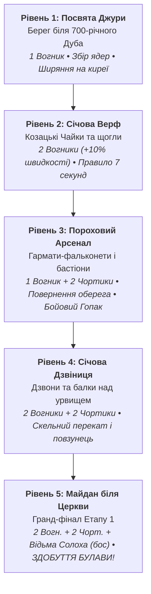

# Сценарій Етапу 1: «Запорозька Січ на Хортиці» (Рівні 1–5)

**Назва кампанії:** *Посвята Джури, Наука Бойового Гопака та Здобуття Булави Котигорошка*  
**Локація:** Острів Хортиця на Дніпрі — козацька столиця, дубові гаї, порохові арсенали, верф козацьких чайок.  
**Головний герой:** Козак Джура (15 років, біла вишиванка, сині шаровари, червона кирея-крила, золотий пояс).  
**Наставник:** Козак-Характерник Мамай (з бандурою, люлькою та мудрими порадами).  
**Супротивники:** Купальський Вогник (палій ґнотів), Чортик-крутько (крадій ядер), Відьма Солоха (бос Етапу 1 на мітлі).  
**Кульмінаційна нагорода:** Легендарна Булава Котигорошка.  
**Вікова категорія:** 8–14 років.  
**Стиль:** Золота доба української анімації («Київнаукфільм», Zero-Horror I-3).

---

## 1. Карта та структура рівнів Етапу 1

---

## 2. Пізнавальні скарби для дітей (Чому це цікаво й повчально):
1. **Хортиця та Січ:** Діти дізнаються, що Хортиця була найбільшим річковим островом Європи та неприступною природною фортецею козаків.
2. **Козацька Чайка (Рівень 2):** Безпалубний корабель із поясом із очерету, що робив його непотоплюваним навіть у морський шторм.
3. **Холоднокровність перед небезпекою (Правило 7 секунд):** Пороховий ґніт шипить 7 секунд до детонації. Гра вчить дитину не панікувати, а розраховувати час і ступати твердо.
4. **Бойовий Гопак як гімнастика та бойове мистецтво:**
   - *«Прямий сталевий тичок»* — удар кулаком, що збиває ворога на місці.
   - *«Тинок»* — високий мах ногою, що вибиває вкрадене ядро з лап Чортика.
   - *«Повзунець»* — нижня підсічка у присіді, що збиває ворога з ніг.
   - *«Щупак»* — розніжка в повітрі з дотиком до пальців чобіт.

---

## 3. Повні діалоги та слайди перед кожним рівнем

### 🎬 Рівень 1: «Посвята Джури та Перше Ядро»
* **Локація:** Берег Хортиці під крислатим 700-річним Дубом. Дерев'яні помости, сині дніпровські хвилі.
* **Слайд 1 (Урок самовладання):**  
  > **Характерник Мамай:** «Дивись на Дніпро, Джуро! Вода тече спокійно, оминаючи гранітні пороги. Так і козак: коли зустрічає перешкоду — не розбиває лоба, а зберігає спокій і шукає вірну стежку. Бачиш верхівки помостів? Там розкидані перші ядра Січі.»  
  > **Джура:** «Я бачу їх, Батьку! Я доведу, що вартий козацького імені!»
* **Слайд 2 (Крила киреї):**  
  > **Характерник Мамай:** «Коли під ногами зникає міст — не бійся прірви. Твоя червона кирея зіткана з козацького шовку. Широко розкинь руки, мов крила птаха, і вітер Дніпра м'яко перенесе тебе на сусідню балку!»  
  > **Джура:** «Ширяти над водою, мов сокіл?! Неймовірно!»
* **Слайд 3 (Золота іскра):**  
  > **Характерник Мамай:** «Стережися: з трави вискочив бешкетний Купальський Вогник! Він стрибає по дошках і намагається підпалити ґноти. Захисти ядра, Джуро!»

### 🎬 Рівень 2: «Січова Верф та Спритний Вогник»
* **Локація:** Затока Хортиці. Стапелі чайок, корабельні канати, запах смоли та свіжого дуба.
* **Слайд 1 (Козацький флот):**  
  > **Джура:** «Батьку, які величні човни! Це на них запорожці долали Чорне море?»  
  > **Характерник Мамай:** «Так, сину. Це наші Чайки. По бортах у них — снопи сухого очерету. Вони тримають човен на плаву в будь-яку негоду. Але Вогник розлютився і тепер скаче по щоглах набагато швидше!»
* **Слайд 2 (Правило 7 секунд):**  
  > **Характерник Мамай:** «Затям правило гармашів: якщо Вогник торкнеться бомби — ґніт пустить сизий дим і шипітиме рівно **7 секунд**! Не біжи наосліп. Рахуй подумки, тримай рівновагу і збий іскру полицею киреї!»  
  > **Джура:** «Сім секунд спокою... Зрозумів! Очі пильні, крок упевнений!»
* **Слайд 3 (Лицарська гідність):**  
  > **Характерник Мамай:** «Справжній витязь починає свій шлях без заліза, гартуючи власне тіло та дух. Уперед на верф!»

### 🎬 Рівень 3: «Пороховий Арсенал та Повернення Чортика»
* **Локація:** Бастіони порохової скарбниці. Гармати, ковані скрині, діжки з порохом.
* **Слайд 1 (Зустріч з кривдником):**  
  > **Джура (показуючи на балку під дахом):** «Батьку! Погляньте туди! Це ж він — той самий капосний Чортик-крутько! І дідусів вишитий оберіг у нього на розі!»  
  > **Чортик (згори, корчачи пику):** «Ой-вей, невже той самий хлопчисько з кропиви прибіг у червоних крилах?! А я ядра цуплю й на верхівку ховаю, ти мене ніколи не дістанеш!»
* **Слайд 2 (Сила Бойового Гопака):**  
  > **Характерник Мамай:** «Не піддавайся на провокації, сину. Час показати козацьку зброю! Прямий сталевий тичок зупиняє ворога, а маховий удар «Тинок» відкидає крутька геть і вибиває вкрадене ядро з лап!»  
  > **Джура:** «Цього разу я не розмахуватиму руками наосліп. Тримайся, рогатий!»
* **Слайд 3 (Тандем нечисті):**  
  > **Характерник Мамай:** «Чортик розливає липку смолу, а Вогник підпалює ґноти. Дій на випередження!»

### 🎬 Рівень 4: «Січова Дзвіниця та Фортечний Паркур»
* **Локація:** Високі яруси дозорної вежі над Дніпром. Вітер, скрипучі балки, старовинні мідні дзвони.
* **Слайд 1 (Погляд орла):**  
  > **Джура:** «Оце височінь! Звідси видно все Дике Поле аж до далеких курганів!»  
  > **Характерник Мамай:** «Дзвіниця — це очі Січі. Звідси вартові подають сигнал усьому козацькому товариству. Але балки тут вузькі, а нечисть розставила пастки!»
* **Слайд 2 (Козацький перекат):**  
  > **Характерник Мамай:** «Козак не падає — козак перекочується! Приземляючись на повній швидкості, групуйся в козацький перекат. Це збереже хід і не дасть збити тебе з ніг!»  
  > **Джура:** «Я вже відчуваю кирею як рідні крила! Жодне ядро не вибухне на дзвіниці!»
* **Слайд 3 (Передчуття головної битви):**  
  > **Характерник Мамай:** «Хтось сильний і підступний керує цими капостями з висоти. Очисти дзвіницю — і рушаймо на головний майдан!»

### 🎬 Рівень 5: «Майдан біля Церкви та Битва з Відьмою Солохою» (Фінал Етапу 1)
* **Локація:** Головна площа біля Січової церкви Покрови Богородиці. Грозове нічне небо, смолоскипи.
* **Слайд 1 (Поява Відьми на мітлі):**  
  > **Джура:** «Батьку, небо затягнуло кіптявою! Хто це кружляє над хрестами церкви верхи на березовій мітлі?!»  
  > **Відьма Солоха (регоче з неба):** «Хі-хі-хі! Дурні козаченьки! Думали зібрати порох і святкувати?! А я накрию ваших чортиків магічними щитами! Спробуй тепер, хлопчиську, пробити мої чари!»
* **Слайд 2 (Двофазний захист):**  
  > **Характерник Мамай:** «Це Солоха! Вона затуляє чортів магічним щитом — перший удар розколює її захисне коло, а другий збиває нахабу з ніг! А коли відьма спуститься за новою порцією сажі — дай їй козацького щигля!»  
  > **Джура:** «За Січ, за дідуся, за правду — стоятиму до кінця!»
* **Слайд 3 (Слепстік-поразка та Вручення Булави Котигорошка):**  
  *(Після перемоги: відьма розбиває мітлу об копицю сіна, Чортик верещить, губить дідусів оберіг і чкурнув геть! Хортиця врятована!)*  
  > **Характерник Мамай:** «Ти переміг, Джуро! Ти повернув дідусів оберіг, урятував Січ і довів чистоту свого серця! За рішенням Січової Ради тобі вручається найбільша реліквія — **Легендарна Булава Котигорошка**!»  
  > **Джура (підіймаючи сяючу булаву):** «Вона легка, мов соснова гілка, але в ній відчувається сила рідної землі!»  
  > **Характерник Мамай:** «Вона викувана з небесного каменю і трощить будь-яку темну броню. Але бережи її: вона служить лише тому, хто захищає справедливість!»
